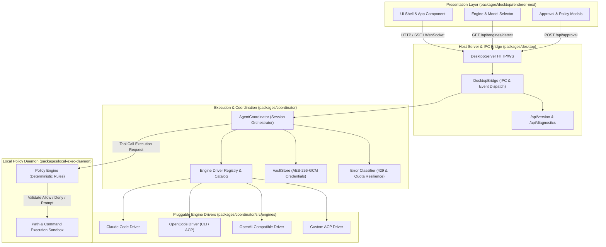

# OpenSand architecture, modelled on OpenMausBot

## 1. Side-by-side map

| Layer / Area | OpenMausBot Architecture (Source & Docs) | OpenSand Architecture & Gaps (Codebase) |
| --- | --- | --- |
| **Engine & Driver Registry** | **Source**: `server/engine-versions.ts:25` (`ENGINE_VERSIONS` pin table), `server/runtime/capabilities.ts:20` (`ENGINES` capability matrix), `docs/custom-engines.md:33` (`customAcp` driver). Provides declarative driver binding, version pins, capability flags (`resume`, `subagents`, `nativeReviewer`), and hermetic driver isolation. | **Source**: `packages/coordinator/src/engines/external-engine-runner.ts:14` (`ExternalEngineTurnRunnerOptions`), `packages/coordinator/src/engines/types.ts:1` (`ExternalEngineConfig`). **Gap**: OpenSand lacks a declarative driver registry and capability matrix; engine selection is branch-checked in `packages/desktop/src/ipc-bridge.ts:786` and executed via a monolithic runner. |
| **Server & Harness** | **Source**: `server/index.ts:11` (HTTP/WS server), `server/runtime/types.ts:9` (`Origin`, `Assignment`), `docs/runtime-contract.md:9` (`TurnRunner` contract). Maintains one immutable assignment lifecycle, wake lanes, origin quote provenance, and process watchdog per bot turn. | **Source**: `packages/desktop/src/desktop-server.ts:1` (`DesktopServer`), `packages/coordinator/src/coordinator.ts:86` (`AgentCoordinator`). **Gap**: OpenSand embeds turn coordination directly into Desktop server; lacks persistent assignment state machines, wake queues, and formal origin lineage across agent turns. |
| **Renderer & UI** | **Source**: `src/App.tsx:479` (SPA Shell), `electron/place-inbox-watch.mjs:1` (Electron state synchronizer). Unified sidebar for bots, threads, real-time token streaming, inline approval cards, and dynamic model pickers. | **Source**: `packages/desktop/renderer-next/src/main.tsx:1` (`renderer-next` entry), `packages/desktop/src/index.ts:1` (Electron main). **Gap**: OpenSand is mid-migration from legacy `renderer/` to `renderer-next/`; lacks unified multi-agent inbox, structured approval cards, and dynamic engine model selector. |
| **Settings & Config** | **Source**: `server/config.ts:732` (`loadConfig` reading `~/.openmausbot/config.json`), `docs/openmausbot-docs/index.md` (data folder specification). Plain JSON schema (mode 0600) with multi-instance engine definitions (`instances`), per-bot configurations, and runtime environment overrides. | **Source**: `packages/coordinator/src/vault-store.ts:69` (`VaultStore` AES-256-GCM vault in `~/.opensand/vault.enc`), `packages/desktop/src/ipc-bridge.ts:89` (`DesktopSettings`). **Gap**: Encrypted credentials are secure, but configuration lacks declarative engine instance multi-tenancy and per-bot override layers. |
| **Model Discovery for Each Engine** | **Source**: `server/drivers/acp/opencode-go.ts:186` (`parseOpenCodeModelsOutput` parsing `opencode models --verbose`), `docs/opencode-go.md:48`, `server/hosted-models.ts:10`. Dynamic model catalog querying via CLI `--verbose` flags, ACP `session/set_config_option`, and remote `/models` endpoints with fallback caching. | **Source**: `packages/desktop/src/desktop-server.ts:575` (`GET /api/engines/detect`), `packages/desktop/src/ipc-bridge.ts:786` (`detectEngines`). **Gap**: OpenSand only verifies executable presence (`which`); it does not probe providers for available models, pricing tiers, or effort configurations. |
| **Version Reporting** | **Source**: `server/drivers/acp/version-probe.ts:1` (CLI version probe), `server/index.ts:11` (`GET /api/version`). Probes installed engine CLIs against known pins in `ENGINE_VERSIONS` and returns holistic server + engine version diagnostics. | **Source**: `packages/desktop/src/desktop-server.ts:622` (`GET /api/version`), `packages/desktop/src/build-diagnostics.ts:1` (`buildDiagnosticsReport`). **Gap**: `/api/version` returns only static app and Electron versions; it does not report active engine versions or warn when local engine CLIs drift from supported releases. |
| **Release & Installation** | **Source**: `electron-builder.yml:1` (packaging spec), `docs/release.md` / `scripts/release.sh:1`. Automated packaging across macOS and Linux, zero-bump direct tag promotions, and atomic in-place updates. | **Source**: `scripts/release.sh:107` (version bump PR), `scripts/install-health-check.sh:13` (isolated smoke check). **Gap**: Release workflow is blocked by a separate version-bump PR roundtrip (`release.sh:107-209`), and post-install health check validates a temporary sandbox rather than the active running process. |

## 2. Target architecture

### 2.1 Module architecture

The target architecture decouples presentation, execution orchestration, security policy, and engine drivers across strict IPC boundaries:

### 2.2 Decision ownership

| Decision | Owning Module | Source Location | Invariants & Decision Authority |
| --- | --- | --- | --- |
| **Tool Approval & Policy Evaluation** | `Local Policy Daemon` | `packages/local-exec-daemon/src/policy-engine.ts:125` | Deterministic offline rule evaluation (`DENY`, `REQUIRE_APPROVAL`, `ALLOW`). Never consults an LLM at evaluation time; prompt injection cannot widen permissions. |
| **Engine Selection & Fallback** | `Coordinator / Engine Registry` | `packages/coordinator/src/engines/external-engine-runner.ts:47` | Chooses active engine based on configured user settings, local capability flags (`resume`, `stepCap`), and provider error status. Automatically switches to fallback engine on quota lockouts. |
| **Model Discovery & Catalog Caching** | `Pluggable Engine Drivers` | `packages/coordinator/src/engines/` | Probes engine CLI / remote `/models` endpoint for qualified model IDs and parameters. Caches catalog locally and serves cached values when network or CLI discovery is transiently degraded. |
| **Credential Security & Decryption** | `Vault Store` | `packages/coordinator/src/vault-store.ts:69` | Unlocks AES-256-GCM encrypted tokens in memory only when required. Plaintext keys are never serialized to configuration files, renderer payloads, or terminal logs. |
| **Session Lifecycle & Context Assembly** | `Agent Coordinator` | `packages/coordinator/src/coordinator.ts:86` | Manages turn state machines, bounds max turn iterations, stitches transcript history, and serializes token event streams to callers. |
| **IPC & Security Boundary Enforcement** | `Desktop Server & Bridge` | `packages/desktop/src/desktop-server.ts:1` & `packages/desktop/src/ipc-bridge.ts:69` | Validates local loopback origins, ensures authentication tokens for sensitive endpoints, and prevents renderer execution context from executing unsanctioned system APIs. |
| **Presentation & User Input** | `Renderer Next UI` | `packages/desktop/renderer-next/src/main.tsx:1` | Renders conversational streams, interactive approval requests, diagnostic summaries, and model selection menus. |
## 3. Migration order

The transition to Architecture v2 proceeds in 5 ordered, test-verified slices:

### Step 1: Dynamic Engine Model Discovery & Selector UI
- **Scope**: Implement dynamic model catalog discovery in `packages/coordinator/src/engines/` and `/api/engines/detect` in `packages/desktop/src/desktop-server.ts:576`. Probes provider endpoints (`/models`) and CLIs (`opencode models --verbose`, `claude`) to populate engine options and qualified model identifiers. Updates `packages/desktop/renderer-next/` with a dynamic model dropdown for each configured engine account.
- **Done-When Test**: `packages/desktop/test/engine-model-discovery.test.ts` passes: mocked provider and CLI responses yield a populated model catalog in `GET /api/engines/detect`, and selecting a model persists across subsequent turn queries.

### Step 2: Hotfix Path & Release Pipeline Hardening
- **Scope**: Full implementation of Section 4:
  1. `release.sh:518` terminates active running `/Applications/OpenSand.app`, relaunches new bundle, and verifies live `/api/version` and `/api/engines/detect` match the release tag.
  2. Eliminates standalone version-bump PRs from `release.sh:107-209`; CI on `main` builds and tests release artifacts for direct tag promotion.
  3. Inserts owed `(cd "$REBASE_WT" && bash "$ROOT/scripts/setup-git.sh")` into `scripts/pr-gate.sh:437` to activate the `INDEX.md` merge driver.
  4. Adds automated PNG test-artifact rejection to `scripts/pre-commit.sh:31` and reinforces Check 3 in `scripts/pr-gate.sh:729-738`.
  5. Configures a hotfix bot on an independent provider with automated 429 quota error classification in `packages/coordinator/src/errors.ts:36` and instant fallback switching.
- **Done-When Test**: `scripts/release-check.sh`, `scripts/install-health-check-selftest.sh`, `scripts/pre-commit-selftest.sh`, and `scripts/pr-gate-selftest.sh` pass green without manual intervention.

### Step 3: Pluggable Driver Registry & Capability Matrix
- **Scope**: Decompose monolithic `ExternalEngineTurnRunner` (`packages/coordinator/src/engines/external-engine-runner.ts`) into dedicated drivers (`ClaudeDriver`, `OpenCodeDriver`, `OpenAIDriver`, `CustomAcpDriver`). Create central driver registry and capability matrix (`resume`, `nativeReviewer`, `stepCap`) modeled after OpenMausBot (`server/runtime/capabilities.ts:20` and `server/engine-versions.ts:25`).
- **Done-When Test**: `packages/coordinator/test/engine-registry.test.ts` passes: each driver registers, advertises capabilities, executes isolated mock turns, and cleanly resumes sessions.

### Step 4: Strict Policy Daemon IPC & Security Sandbox
- **Scope**: Enforce rigid process and IPC isolation for `packages/local-exec-daemon/src/policy-engine.ts`. All file operations, command executions, and privilege requests must route through structured RPC calls. Policy evaluation runs strictly offline without LLM dependencies.
- **Done-When Test**: `packages/local-exec-daemon/test/policy-ipc-isolation.test.ts` passes: unapproved destructive commands fail closed across IPC boundaries, and prompt-injection attacks cannot grant tool access.

### Step 5: Unified Session Inbox & Renderer-Next Cutover
- **Scope**: Complete the cutover from legacy `packages/desktop/renderer` to `packages/desktop/renderer-next`. Deliver unified session inbox, live token streaming, interactive approval modals, and real-time support diagnostics.
- **Done-When Test**: `packages/desktop/test/settings-welcome-real-window.test.ts` and visual smoke verification pass with all views rendered exclusively by `renderer-next`.
## 4. Hotfix path

Target: Under 2 hours from bug report to fix installed.

### 4.1 Stage sequence

The hotfix lifecycle spans 7 stages from initial triage to verified production confirmation:
`report` → `fix` → `verify` → `merge` → `release` → `install` → `confirm`.

| Stage | Time Budget | Owner (file:line) | Test / Verification |
| --- | --- | --- | --- |
| `report` | 10 min | `scripts/worktree.sh:1` (`worktree.sh new`) | `scripts/worktree-selftest.sh` |
| `fix` | 40 min | `scripts/pre-commit.sh:1` (developer loop) | Targeted package test suite (e.g. `pnpm --filter coordinator test`) & `scripts/pre-commit-selftest.sh` |
| `verify` | 15 min | `scripts/verify.sh:1` & `.github/workflows/ci.yml:11,45,86` | `scripts/verify-selftest.sh` & CI matrix (`Build & test`, `Security gates`) |
| `merge` | 15 min | `scripts/pr-gate.sh:1` (Checks 1–5, lines 548–820) | `scripts/pr-gate.sh --dry-run` & `scripts/pr-gate-selftest.sh` |
| `release` | 20 min | `.github/workflows/release.yml:11` & `scripts/release.sh:1` | `scripts/release-check.sh` & `scripts/smoke-packaged.sh` / `scripts/smoke-linux.sh` |
| `install` | 10 min | `scripts/release.sh:518` (`--install` routine) | `scripts/install-health-check.sh` (at `scripts/release.sh:573`) |
| `confirm` | 10 min | `packages/desktop/src/desktop-server.ts:576,623` (`/api/engines/detect`, `/api/version`) | Live process probe (`curl http://127.0.0.1:<port>/api/version`) & `packages/desktop/test/settings-welcome-real-window.test.ts` |

Total time budget: 120 minutes (2.0 hours).

### 4.2 Known failure modes and architectural resolutions

| Problem | Time / Budget Impact | Owner (file:line) | Test / Verification | Resolution |
| --- | --- | --- | --- | --- |
| **a) Install left old process running** | +15 min (manual triage / undetected stale process) | `scripts/release.sh:518-578` & `scripts/install-health-check.sh:6-10` | `scripts/install-health-check-selftest.sh` & running process health probe | `install-health-check.sh` today launches an isolated bundle copy in a fresh temporary directory (`/tmp/opensand-health.XXXXXX`) and leaves any active `/Applications/OpenSand.app` instance untouched. `release.sh` must quit the existing application instance (e.g., via AppleScript `tell application "OpenSand" to quit` or bounded `kill -TERM`), copy the new app bundle, launch the updated application, and probe the running process's live HTTP endpoints `GET /api/version` (`packages/desktop/src/desktop-server.ts:623`) and `GET /api/engines/detect` (`packages/desktop/src/desktop-server.ts:576`) to verify that the active process version matches the release tag before declaring installation complete. |
| **b) Remove separate version-bump PR** | +20–40 min (unnecessary PR creation, CI wait, rebase, and gating roundtrip) | `scripts/release.sh:107-209` & `.github/workflows/release.yml:11` | `scripts/release-check.sh` & CI artifact verification | Eliminate the standalone `chore/bump-v<version>` PR and gating cycle in `release.sh:107-209`. Instead, have CI on each merge to `main` (`.github/workflows/ci.yml`) automatically build and test release artifacts. When a tag is pushed or release triggered, `release.sh` and `.github/workflows/release.yml` promote the pre-built, tested artifact directly to GitHub Release assets. All checks (license/provenance gate, security audit, smoke tests, Info.plist version check) are preserved without the extra PR latency. |
| **c) INDEX.md rebase conflicts** | +10–25 min (rebase halt during pre-merge gate) | `scripts/pr-gate.sh:437` & `scripts/setup-git.sh:1` | `scripts/lessons-index-merge-selftest.sh` | Generated lesson index conflicts on rebases are solved by the custom git merge driver introduced in PR #263 (commit `7a91a89c`), registered via `.gitattributes`. To make this driver active in the gate's temporary detached rebase worktree, `pr-gate.sh` owes one call immediately following `git worktree add --detach "$REBASE_WT" "$REBASE_REF"` at line 437: `(cd "$REBASE_WT" && bash "$ROOT/scripts/setup-git.sh")`. |
| **d) PNG test artifacts committed or gated** | +10 min (failed CI / tainted repo diff) | `scripts/pre-commit.sh:31` & `scripts/pr-gate.sh:729-738` | `scripts/pre-commit-selftest.sh` & `scripts/pr-gate-selftest.sh` | Test runs (e.g., visual snapshot or real-window browser tests) can leave binary `.png` screenshots in the worktree. Enforce an automated check in `scripts/pre-commit.sh` refusing staged or untracked test-artifact PNGs before `git commit` completes, and reinforce Check 3 in `scripts/pr-gate.sh:729-738` so binary PNG test artifacts in PR diffs are strictly rejected by the pre-merge gate unless explicitly exempted with `--allow-binary`. |
| **e) Engine quota / rate-limit lockout** | +30–60 min (agent blocked on 429 quota exhaustion) | `packages/coordinator/src/errors.ts:36-88` & `packages/desktop/src/desktop-server.ts:576` | `packages/coordinator/test/provider-error-handling.test.ts` & `packages/desktop/test/engine-selection.test.ts:102-113` | If an AI engine exhausts its token quota or hits HTTP 429 rate limits during hotfix authoring, work halts. Maintain at least one dedicated hotfix bot configured with an independent model provider (e.g. Anthropic Claude vs OpenAI/Gemini). At the application layer, `classifyError()` in `packages/coordinator/src/errors.ts` parses provider error responses, assigns `RATE_LIMIT_EXCEEDED`, and passes actionable retry/fallback guidance to `DesktopBridge`. The UI/server offers an instant switch to a secondary configured fallback engine (`/api/engines/detect`) without losing turn context or requiring manual config surgery. |

## 5. Risks and deliberate differences
TODO

## 6. Open questions
TODO
