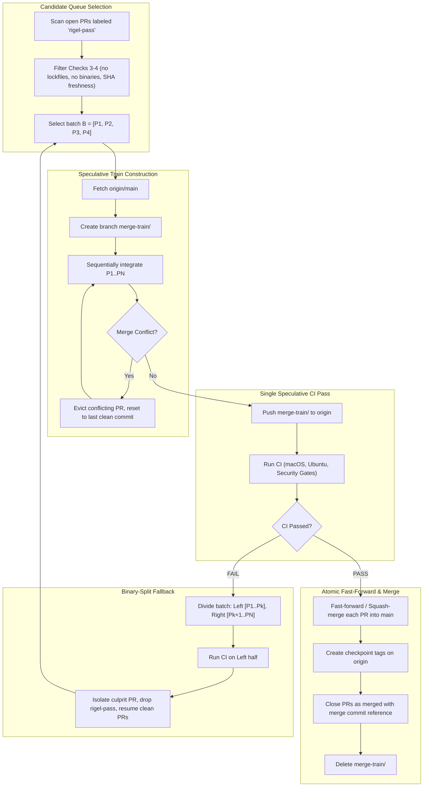

# Speculative Batch Merge Train Architecture (`scripts/pr-gate-batch.sh`)

**Author:** Ada (AI Systems Architect)  
**Date:** 2026-11-25  
**Status:** Decided & Build-Ready (Execution Specification for Atlas)  
**Parent Architecture:** [OpenSand Architecture v2](architecture-v2.md), [Step 3 Engine Registry Brief](step3-engine-registry-brief.md), `scripts/release.sh`

---

## 1. Executive Summary & Problem Statement

Currently, pull request verification and merging into `origin/main` is orchestrated serially by `scripts/pr-gate.sh`. Under this model, merging any PR follows a strictly sequential lifecycle:
1. Verify PR base is current with `origin/main` (`scripts/pr-gate.sh` Check 2).
2. If the base SHA differs from `origin/main`, update the PR branch (`gh pr update-branch`).
3. Wait for full GitHub Actions CI (`ci.yml`: `Build & test (Node 22)`, `Build & test (macOS, Node 22)`, and `Security gates`).
4. Execute `gh pr merge --merge` and create `checkpoint/<date>/main-before-pr-<PR>` tag.

### The Serial Throughput Bottleneck
Each GitHub Actions macOS CI run consumes **8 to 10 minutes**. Whenever a PR is merged, `origin/main` advances, immediately invalidating the base commit (`baseRefOid`) of every other queued PR. As a consequence:
- PR #2 must rebase/update and wait 10 minutes.
- PR #3 must rebase/update and wait another 10 minutes.
- PR #4 must rebase/update and wait another 10 minutes.

This imposes a hard theoretical ceiling of **5 to 6 PRs per hour**. When multiple autonomous agents (Dex, Nova, Pixel, Vega, Rigel) generate features, fixes, and docs concurrently, the PR queue backs up, stalling engineering velocity.

### The Accelerating Solution: Speculative Batch Merge Train
This specification introduces `scripts/pr-gate-batch.sh`, a speculative batch merge train coordinator. Instead of verifying PRs serially, the batch train speculatively integrates $N$ (default 4 to 5) `rigel-pass` candidate PRs onto a single temporary branch (`merge-train/<timestamp>`) and validates the entire batch with **one single 10-minute CI run**.

| Metric | Serial `pr-gate.sh` | Speculative Batch `pr-gate-batch.sh` ($N=4$) | Acceleration Factor |
|---|---|---|---|
| **CI Runs for 4 PRs** | 4 sequential runs (40 min) | 1 batch run (10 min) | **4.0x faster** |
| **Throughput Ceiling** | ~6 PRs / hour | **24 to 30+ PRs / hour** | **4x to 5x increase** |
| **macOS Runner Minutes** | ~40 min per 4 PRs | ~10 min per 4 PRs | **75% compute savings** |
| **Failure Handling** | Serial stall on failure | Binary-split bisection eviction | **Guarantees zero stall** |

---

## 2. Speculative Batch Architecture & Lifecycle



---

## 3. Step-by-Step Batch Execution Protocol

### Step 1: Candidate Selection & Pre-Flight Checks
Atlas invokes `scripts/pr-gate-batch.sh --batch-size 4`. The script queries GitHub for candidates:
1. **Query:** `gh pr list --state open --label rigel-pass --json number,title,headRefOid,baseRefOid,labels,mergeable`.
2. **Pre-flight Filter (Checks 3 & 4):**
   - Must be `mergeable === "MERGEABLE"`.
   - Must carry `rigel-pass` stamped on the *latest* commit SHA (`headRefOid`).
   - Must contain no forbidden files (`pnpm-lock.yaml`, `.github/` without `owner-approved-github`, binary PNG/JPG/ZIP/DMG files).
3. **Sort:** Order candidate PRs by ascending PR number (FIFO queue order). Select top $N$ (default 4).

### Step 2: Speculative Integration Branch Construction
1. Fetch `origin/main` to ensure latest base SHA:
   ```bash
   git fetch origin main
   TRAIN_BASE=$(git rev-parse origin/main)
   TRAIN_ID=$(date +%Y%m%d-%H%M%S)
   TRAIN_BRANCH="merge-train/$TRAIN_ID"
   git checkout -b "$TRAIN_BRANCH" "$TRAIN_BASE"
   ```
2. For each candidate PR $P_i$ in batch $[P_1, \dots, P_N]$:
   - Fetch the PR head: `git fetch origin pull/$P_i/head:pr-$P_i-head`
   - Attempt clean merge or cherry-pick onto the train branch:
     ```bash
     if ! git merge --no-ff -m "train($TRAIN_ID): speculative merge PR #$P_i" "pr-$P_i-head"; then
       echo "CONFLICT: PR #$P_i conflicts with prior train commits; evicting from batch"
       git merge --abort
       # Evict PR from current train, notify PR, and continue with remaining candidates
       evict_pr "$P_i" "Merge conflict during speculative batch integration."
       continue
     fi
     ```
3. If all candidates fail due to conflicts, exit cleanly without modifying `origin/main`.

### Step 3: Single Speculative CI Pass
1. Push the constructed train branch:
   ```bash
   git push origin "$TRAIN_BRANCH"
   ```
2. Trigger and monitor GitHub Actions CI for `$TRAIN_BRANCH`:
   - `Build & test (Node 22)`
   - `Build & test (macOS, Node 22)`
   - `Security gates (audit + secret scan)`
3. Await completion with an explicit timeout (maximum 15 minutes, 900,000 ms). No polling spin-loops; use GitHub CLI watch API (`gh run watch` or event checks).

### Step 4: Promotion & Sequential Checkpoint Merge
When the speculative CI pass succeeds:
1. All PRs in the batch are verified to be green against `origin/main` and mutually compatible.
2. Advance `origin/main` sequentially for each PR in the passing batch:
   - For each PR $P_i$:
     - Create and push checkpoint tag: `checkpoint/$(date +%Y-%m-%d)/main-before-pr-$P_i` pointing to current `origin/main`.
     - Fast-forward or merge PR $P_i$ into `origin/main` via `gh pr merge $P_i --squash` or cherry-pick replay.
     - Verify PR state changes to `MERGED`.
3. Delete temporary speculative branch `$TRAIN_BRANCH` both locally and on `origin`.

---

## 4. Binary-Split Bisection Fallback (Eviction Algorithm)

If the combined speculative branch fails CI, one or more PRs contain a bug, a regression, or an incompatible change. Rather than dropping all $N$ PRs, the batch train executes a deterministic binary-split bisection:

### Formal Bisection Protocol
Given batch $B = [P_1, P_2, \dots, P_N]$ that failed CI:

1. **Split:** Divide batch $B$ into left half $B_L = [P_1, \dots, P_k]$ and right half $B_R = [P_{k+1}, \dots, P_N]$, where $k = \lfloor N/2 \rfloor$.
2. **Test Left Half ($B_L$):**
   - Create speculative branch `merge-train/<id>-L` containing only $B_L$ on `origin/main`.
   - Run CI.
3. **Outcome A — Left Half Passes:**
   - Immediately promote and merge all PRs in $B_L$ into `origin/main`!
   - Candidate set $B_R$ is re-evaluated against the new `origin/main`. If $|B_R| > 1$, bisect $B_R$; if $|B_R| == 1$, the culprit is isolated.
4. **Outcome B — Left Half Fails:**
   - The culprit resides within $B_L$.
   - If $|B_L| == 1$, the culprit PR $P_1$ is definitively isolated.
   - If $|B_L| > 1$, recursively split $B_L$.
5. **Culprit Eviction:**
   - Remove `rigel-pass` label: `gh pr edit $P_{bad} --remove-label rigel-pass`.
   - Post diagnostic failure comment to PR $P_{bad}$ with the exact failing CI log excerpt.
   - Return remaining healthy PRs to the queue.

### Mathematical Worst-Case Efficiency
For a batch of $N=4$ with 1 failing PR:
- Pass 1 (combined batch $N=4$): Fails (10 min).
- Pass 2 (left half $N=2$): Passes (10 min) $\rightarrow$ **PR #1 and PR #2 merged immediately!**
- Pass 3 (right half $N=2$ split to $N=1$): Isolates culprit PR #3, merges PR #4.
- Total time: 30 minutes for 3 merged PRs (10 min/PR), whereas serial testing with re-rebasing would have taken 40+ minutes and stalled on the failure.

---

## 5. Safety Invariants & Concurrency Guards

The batch merge train strictly preserves all 5 checks from `scripts/pr-gate.sh` without regression:

| Gate / Check | Verification in Batch Train | Invariant Preserved |
|---|---|---|
| **Check 1: CI Green** | Verified on the combined speculative branch `merge-train/<ts>` before any commit reaches `main`. | Zero unverified code enters `main`. |
| **Check 2: Base Freshness** | Train branch is always cut from the latest `origin/main` SHA. | Prevents stale-base regressions. |
| **Check 3: Clean Diff** | Pre-flight node script inspects diffs of all candidate PRs; rejects `pnpm-lock.yaml`, `.github/`, and binary files. | Prevents supply-chain poison and lockfile churn. |
| **Check 4: Rigel PASS** | Validates `rigel-pass` label and verifies label commit SHA equals PR `headRefOid`. | Ensures QA sign-off was not invalidated by subsequent commits. |
| **Check 5: Checkpoints** | Pushes `checkpoint/<date>/main-before-pr-<PR>` tags to origin before each PR promotion. | Enables instantaneous git rollback to any pre-PR state. |

### Concurrency Lock Guard
To prevent race conditions where two batch trains run simultaneously, or a batch train races with a manual `scripts/pr-gate.sh` invocation:
1. **Lockfile Location:** `~/.opensand/merge-train.lock` (mode `0600`).
2. **Lock Payload:** JSON containing `pid`, `trainId`, `startTime`, and `host`.
3. **Acquisition:** Atomic file creation via `set -C` / `noclobber` or `shlock`.
4. **Stale Lock Recovery:** If the lock is held by a PID that no longer exists, or if elapsed time exceeds 30 minutes (1,800,000 ms), the lock is considered stale, logged, and evicted.
5. **Trap Release:** Registered on `EXIT`, `INT`, `TERM` signals to guarantee clean release.

### Standalone Design (Non-Interference with PR #261)
This specification does **not** modify `scripts/pr-gate.sh`. Atlas is actively merging PR #261. `scripts/pr-gate-batch.sh` is designed as an autonomous orchestration script that runs alongside `scripts/pr-gate.sh` and consumes existing repository gates.

---

## 6. Self-Test Plan (`scripts/pr-gate-batch-selftest.sh`)

To prove correctness before production deployment, `scripts/pr-gate-batch-selftest.sh` executes 5 automated test scenarios inside an isolated temporary bare git repository:

```bash
# Executed via scripts/pr-gate-batch-selftest.sh
```

1. **Test 1: Happy Path (4 Clean PRs):**
   - Set up bare origin repo with 4 feature branches.
   - Run `pr-gate-batch.sh --batch-size 4 --dry-run`.
   - Assert all 4 PRs integrated into speculative branch, checkpoint tags created, and `origin/main` advanced cleanly.
2. **Test 2: Merge Conflict Eviction:**
   - Feature branch 2 modifies the same lines as feature branch 1.
   - Run batch train.
   - Assert branch 2 is evicted with conflict error, branches 1, 3, 4 pass and merge into `main`.
3. **Test 3: CI Failure Bisection:**
   - Mock CI failure on branch 3.
   - Run batch train with bisection enabled.
   - Assert bisection splits batch, isolates branch 3, and successfully merges branches 1, 2, and 4.
4. **Test 4: Concurrency Lock Mutual Exclusion:**
   - Acquire lock in background subshell.
   - Attempt secondary `pr-gate-batch.sh` invocation.
   - Assert secondary invocation exits with code 1 and error message `FAIL: merge train lock active`.
5. **Test 5: Forbidden File Rejection:**
   - Candidate PR includes a forbidden binary `.png` file.
   - Run batch train pre-flight check.
   - Assert candidate PR is rejected before branch construction.
