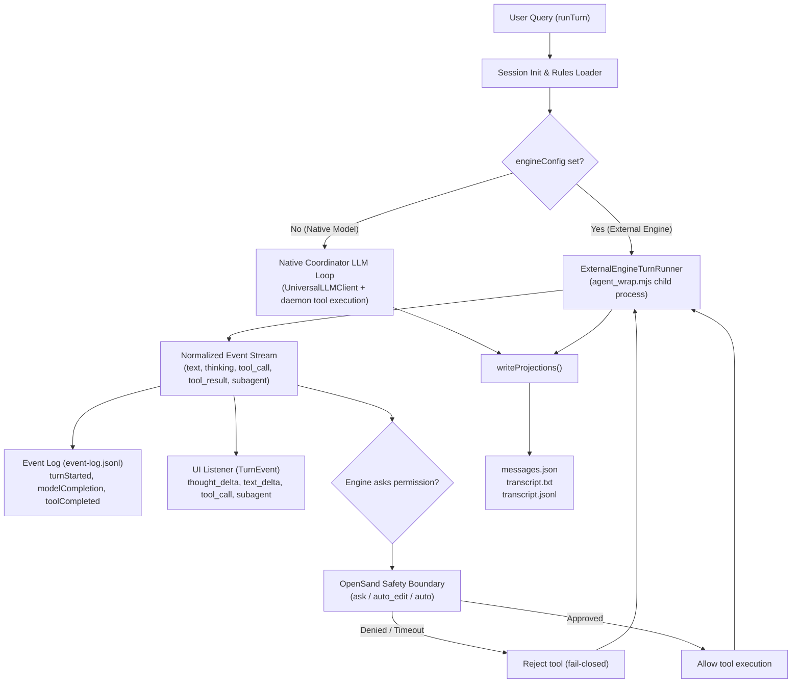
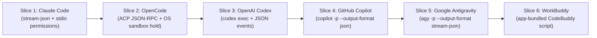

# External Coding-Agent Engines Architecture: Chatting via Signed-In Developer Accounts

**Author:** Ada (AI Systems Architect)  
**Date:** 2026-11-23  
**Status:** Decided & Ratified for Slice-1 Execution  
**Target Implementer:** Dex (Software Engineer)  
**Parent Architecture:** [OpenSand Next](opensand-next.md), [Permissions, Policies, and Safety Gates](../permissions.md), [Event Projections & Coordinator](knows-beforehand.md)

---

## 1. Executive Summary & Decisions at a Glance

OpenSand currently drives multi-turn autonomous coding tasks exclusively through its native tool loop, communicating with stateless LLM completion endpoints (OpenAI-compatible or Anthropic APIs) via `UniversalLLMClient`. While powerful, this requires users to supply raw API keys, configure custom endpoints, and pay per-token cloud API costs.

Meanwhile, developers already possess paid subscriptions and authenticated command-line coding agents on their local machines: **Claude Code** (`claude`), **OpenAI Codex** (`codex`), **GitHub Copilot CLI** (`copilot`), **Google Antigravity** (`agy`), **OpenCode** (`opencode`), and **WorkBuddy / CodeBuddy** (`codebuddy-lite-wb.mjs`).

This design specifies how OpenSand integrates these external coding agents into its chat and coordinator runtime by consuming the finished wrapper `~/SKILLS/coding-agent-engines/scripts/agent_wrap.mjs` and its shared facts `engine_facts.mjs`. This allows users to chat and execute complex engineering tasks through their existing, authenticated coding accounts without entering secrets or sharing credentials.

### Decisions at a Glance

| # | Architectural Dimension | Ratified Decision | One-Line Reason |
|---|---|---|---|
| **1** | **Integration Seam** | **Turn Runner beside the Coordinator LLM Loop (`ExternalEngineTurnRunner`)**, not an LLM client. | External engines manage their own autonomous tool-calling loops and child processes, so they must plug in as a peer turn runner alongside OpenSand's native loop rather than masquerading as a token-streaming LLM client. |
| **2** | **Packaging & Sourcing** | **Vendored Copy in `packages/coordinator/src/engines/vendor/` governed by a committed `PIN` file, build-time asset copy, and CI parity check.** | Packaged Electron distributions require self-contained offline dependencies, a committed `PIN` prevents CI failure on machines lacking `~/SKILLS`, and an asset copy step ensures uncompiled `.mjs` files reach the packaged `.app`. |
| **3** | **Permissions & Safety** | **Fail-Closed Interactive Bridge from OpenSand Modes (`ask` / `auto_edit` / `auto`) to Wrapper `approve()` Callback.** | OpenSand's effect-based safety gates govern all child tool execution via the wrapper's `approve()` callback, enforcing fail-closed rejection with zero permission-bypass flags. |
| **4** | **UX & Lifecycle** | **Passive Detection, Diagnostic Error Surfacing via `explainError`, and Process-Group Lifecycle Control.** | The UX detects installed tools without reading secret stores, translates obscure crash codes into plain English recovery steps via `explainError`, and bounds execution with abortable process groups and idle timers. |
| **5** | **Smallest First Slice** | **Claude Code (`claude`) End-to-End as Slice 1.** | Claude Code provides the cleanest stdio-based interactive permission channel (`--permission-prompt-tool stdio`) matching OpenSand's per-action approval modal, with full stream-json event fidelity already verified on macOS. |
| **6** | **Test Plan** | **Hermetic In-Tree Testing via Wrapper Fakes and OpenSand Coordinator Path.** | Driving existing headless engine fakes through the real coordinator path guarantees 100% reproducible, hermetic testing of events, projections, approvals, and error recovery without real accounts or network access. |

---

## 2. Integration Seam & Event Architecture

### 2.1 The Seam: Why a Turn Runner, Not an LLM Client

In OpenSand, `UniversalLLMClient` (`packages/coordinator/src/llm-client.ts:155`) is an HTTP abstraction over stateless inference endpoints:
```
streamCompletion(messages, toolDefs, signal) -> { stream, getConsolidated, getUsage }
```
It assumes OpenSand controls the outer loop: OpenSand receives tokens, parses structured tool call requests, evaluates safety policies, prompts the user, executes tools via `LocalExecDaemon`, and appends tool output messages back into history.

In contrast, external coding-agent CLIs are **autonomous orchestrators**:
1. They run as standalone child processes (`child_process.spawn`).
2. They maintain their own internal message history, system prompt expansions, and context compression algorithms.
3. They drive their own tool loops internally: reading files, issuing bash commands, creating diffs, and spawning sub-agents.
4. They emit normalized streaming events and request user approvals for tool actions through standard I/O (stdio control requests or ACP JSON-RPC).

Plugging an external engine into `UniversalLLMClient` would require fabricating synthetic HTTP streaming responses and attempting to intercept tool calls before the CLI executes them—an unnatural inversion of control that breaks streaming fidelity.

**Decision:** External engines integrate as a dedicated **Turn Runner** (`ExternalEngineTurnRunner`) plugged directly into `AgentCoordinator.runTurn()` (`packages/coordinator/src/coordinator.ts:223`). When an agent or session is configured with `engineConfig: { type: "external", engine: "claude" | "opencode" | ... }`, `coordinator.runTurn()` routes execution through `ExternalEngineTurnRunner.runTurn()` instead of the native `while (iterations < maxTurnIterations)` LLM loop.



### 2.2 Normalized Event Translation & Transcript Continuity

OpenSand relies on strict invariants for session persistence, resumption, and event log projections (`packages/coordinator/src/event-projections.ts`, `packages/coordinator/src/transcript-manager.ts:380`). When resuming a session, `reconcileTurnInvariants()` verifies that every assistant message containing `tool_calls` has matching `tool` role responses.

The wrapper `agent_wrap.mjs` emits normalized events via its `onEvent` callback. `ExternalEngineTurnRunner` translates these events into OpenSand runtime events and persistent session events in real time:

| Wrapper Event (`agent_wrap.mjs`) | OpenSand Coordinator UI Event (`TurnEvent`) | Persistent Event Log (`event-log.jsonl`) | Projection Invariant Handling |
|---|---|---|---|
| `{ type: "session", id, model }` | Emits `session_resumed` or metadata update. | Recorded in session `metadata.json` under `externalEngine`. | Tracks child engine session ID for continuity. |
| `{ type: "thinking", text }` | `{ type: "thought_delta", text }` | Buffered in memory for turn summary. | Shown in collapsible thinking bubble in UI. |
| `{ type: "text", text }` | `{ type: "text_delta", text }` | Consolidated into final assistant response. | Streamed real-time to chat composer / message bubble. |
| `{ type: "tool_call", id, name, input }` | `{ type: "tool_call_started", toolCall: { id, function: { name, arguments: JSON.stringify(input) } } }` | `EVENT.modelCompletion` with `assistant` message containing `tool_calls: [tc]`. | UI shows tool start card; satisfies tool-call initiation invariant. |
| `{ type: "tool_result", id, output, isError }` | `{ type: "tool_call_completed", toolCallId: id, result: { status, content: output } }` | `EVENT.toolCompleted` with `{ message: { role: "tool", tool_call_id: id, content: output } }`. | Immediately matches the preceding `tool_call`, preventing orphan warnings in `reconcileTurnInvariants`. |
| `{ type: "subagent", parent, event }` | `{ type: "subagent", subagent: { parentId: parent }, event: translatedChildEvent }` | Logged under delegated sub-agent metadata or folded event block. | Renders in UI as nested sub-agent progress card. |
| `{ type: "usage", inputTokens, outputTokens }` | `{ type: "usage_reported", usage }` | Attached to turn completion in `EVENT.modelCompletion`. | Tracks cumulative prompt and completion tokens. |

At the conclusion of the turn:
1. The accumulated assistant text response is recorded in `messages` and emitted as `EVENT.modelCompletion`.
2. `this.transcript.writeProjections()` runs unconditionally.
3. `event-projections.ts:projectMessages()` reconstructs the exact `ChatMessage[]` array, regenerating `messages.json`, `transcript.txt`, and `transcript.jsonl`.
4. If an external engine turn is interrupted mid-execution, OpenSand's `reconcileTurnInvariants()` runs on resume, safely pruning or stubbing any unfulfilled tool calls to prevent corrupting subsequent turns.

### 2.3 Session Continuity & Resume ID Storage

External coding agents maintain their own conversational memory across runs:
- Claude Code uses `--resume <session-id>`.
- Codex uses `codex exec resume <thread-id>`.
- GitHub Copilot CLI uses `--resume <session-id>`.
- Google Antigravity uses `--conversation <conversation-id>`.
- OpenCode uses ACP session identifiers over JSON-RPC.

**Decision:** The engine's session identifier is stored in OpenSand's existing session metadata store at `~/.opensand/sessions/<sessionId>/metadata.json` (managed by `TranscriptManager`).

```json
{
  "sessionId": "a56ab0f9-2d0a-47e5-a7da-f39f1da6f7b3",
  "createdAt": "2026-11-23T11:54:25.000Z",
  "updatedAt": "2026-11-23T11:58:30.000Z",
  "agentId": "software-engineer",
  "externalEngine": {
    "engine": "claude",
    "sessionId": "session-claude-91823-abc",
    "model": "claude-3-7-sonnet-20250219",
    "binaryPath": "/opt/homebrew/bin/claude",
    "version": "2.1.311"
  }
}
```

**Resumption Protocol:**
1. When `coordinator.runTurn()` starts, it loads `metadata.json` via `this.transcript.loadMetadata()`.
2. If `metadata.externalEngine?.sessionId` matches the active engine type, it is passed as `resumeId` to `agent_wrap.runTurn({ engine, resumeId, ... })`.
3. If `agent_wrap` emits a new session identifier (`{ type: "session", id }`), `TranscriptManager` updates `metadata.json` atomically via `writeAtomic()`.
4. If the user changes engines mid-session (e.g. switches from Claude Code to OpenCode), OpenSand starts a fresh session ID for the new engine, rendering the conversation history up to that point as read-only historical context (via `<historical_context_summary>`) so the new engine understands prior decisions without state corruption.

---

## 3. Packaging & Sourcing: The Single-Source Invariant

### 3.1 The Constraint: Packaged App vs. Local Canonical Skills

OpenSand desktop packages into a production DMG / app bundle via `electron-builder` (`electron-builder.yml`). At runtime, a packaged application runs inside an isolated app bundle (e.g. `/Applications/OpenSand.app/Contents/Resources/`) and **cannot** dynamically resolve or import files from arbitrary user directories such as `~/SKILLS/coding-agent-engines/scripts/`.

Simultaneously, two constraints govern packaging:
1. **Catalog Rule:** The repository follows the rule established in `~/SKILLS/CATALOG.md` and `~/SKILLS/WORKFLOW.md`: one real copy exists in `~/SKILLS/coding-agent-engines/`, and other consumers point to it or maintain pinned vendor synchronizations.
2. **CI Portability:** GitHub Actions runners and other developers' machines do not possess `~/SKILLS`. Any check that naively attempts to compare against `~/SKILLS` would fail in CI, breaking `scripts/verify.sh` and `scripts/pr-gate.sh`.

### 3.2 The Decision: Committed `PIN` File and Parity Gate

**Decision:** Vendor `agent_wrap.mjs` and `engine_facts.mjs` in `packages/coordinator/src/engines/vendor/`, governed by a committed `PIN` file:

1. **Vendored Files & Location:**
   - `packages/coordinator/src/engines/vendor/agent_wrap.mjs`
   - `packages/coordinator/src/engines/vendor/engine_facts.mjs`
   - `packages/coordinator/src/engines/vendor/PIN`

2. **The `PIN` File Format:**
   `packages/coordinator/src/engines/vendor/PIN` records the exact cryptographic hash of each file, the upstream source location, and the sync timestamp:
   ```
   # OpenSand Vendored Coding-Agent Engine Wrapper Pin
   # Source: ~/SKILLS/coding-agent-engines/scripts
   # Synced: 2026-11-23T11:42:00Z
   SHA256 (agent_wrap.mjs) = a98b1c4e7...
   SHA256 (engine_facts.mjs) = f40d3a2b1...
   ```

3. **Verification Script: `scripts/check-engine-wrapper-sync.sh`**
   The script executes a two-tiered check:
   - **Tier 1 (Everywhere & CI):** Reads `PIN` and computes the SHA-256 hashes of `packages/coordinator/src/engines/vendor/{agent_wrap.mjs,engine_facts.mjs}`. If the files do not match `PIN` (i.e. someone edited the vendored files in OpenSand by hand), the check **fails hard with exit code 1**. This runs hermetically on any environment without requiring `~/SKILLS`.
   - **Tier 2 (Local Machines with `~/SKILLS`):** If and only if the canonical directory `~/SKILLS/coding-agent-engines/scripts/` exists on the machine, the script computes the SHA-256 of the source files and compares them against `PIN`:
     - If the source has updated ahead of `PIN`, it prints:  
       `NOTICE: vendored copy in OpenSand is behind the source (~/SKILLS/coding-agent-engines/scripts). Run: bash scripts/check-engine-wrapper-sync.sh --sync`
     - **Decision on Warn vs. Fail:** The local source comparison **warns with exit code 0** by default, but **fails with exit code 1** when `--strict` is passed (used during release gates and PR checks).
     - **Rationale:** Local work on unrelated OpenSand features must not stall or fail CI simply because an engineer has experimental uncommitted drafts in `~/SKILLS`. However, the committed `PIN` ensures immutability everywhere, and `--strict` ensures release branches are synchronized.
   - **`--sync` Option:** Running `bash scripts/check-engine-wrapper-sync.sh --sync` copies the files from `~/SKILLS/coding-agent-engines/scripts/` into `packages/coordinator/src/engines/vendor/`, regenerates `PIN`, and prints the updated SHAs.

### 3.3 Packaging Plain `.mjs` into the Built Desktop App (`.app`)

#### The Problem: `tsc` Ignores Plain `.mjs` in `src/`
`packages/coordinator` is a TypeScript package compiled with `tsc -b`. The TypeScript compiler only processes and emits `.ts` files into `dist/`. Non-TypeScript files located under `packages/coordinator/src/engines/vendor/*.mjs` and `PIN` are ignored by `tsc` and omitted from `packages/coordinator/dist/`. Consequently, when `pnpm stage:desktop` stages the app, the vendored `.mjs` files are missing from the build output, causing runtime module resolution failures.

#### The Build & Packaging Solution

1. **Build Step Copy Rule in `packages/coordinator/package.json`:**
   Update the coordinator build script to copy vendor assets after compilation:
   ```json
   "scripts": {
     "build": "tsc -b && node scripts/copy-vendor-assets.mjs",
     "test": "node --test dist/test/**/*.test.js"
   }
   ```
   The helper script `packages/coordinator/scripts/copy-vendor-assets.mjs` ensures:
   ```js
   import fs from "node:fs";
   import path from "node:path";
   const srcDir = "src/engines/vendor";
   const destDir = "dist/src/engines/vendor";
   fs.mkdirSync(destDir, { recursive: true });
   for (const file of ["agent_wrap.mjs", "engine_facts.mjs", "PIN"]) {
     fs.copyFileSync(path.join(srcDir, file), path.join(destDir, file));
   }
   ```

2. **How Compiled TypeScript Imports the Wrapper:**
   In `packages/coordinator/src/engines/external-engine-runner.ts`:
   ```ts
   import { runTurn, findBinary, engineVersion, versionStatus } from "./vendor/agent_wrap.mjs";
   import { explainError, ENGINE_FACTS } from "./vendor/engine_facts.mjs";
   ```
   When `tsc` compiles `external-engine-runner.ts` to `dist/src/engines/external-engine-runner.js`, it retains the exact relative import `./vendor/agent_wrap.mjs`. Because the copy step placed `agent_wrap.mjs` at `dist/src/engines/vendor/agent_wrap.mjs`, Node.js native ESM resolution succeeds both in development and in the built bundle.

3. **Distribution Packaging Pipeline:**
   - **Staging (`pnpm stage:desktop`):** Staging invokes `pnpm --filter @opensand/desktop deploy --prod --legacy dist/stage`. This deploys `@opensand/coordinator` with its `dist/` output into `dist/stage/node_modules/@opensand/coordinator/dist/`.
   - **Electron Bundling (`electron-builder.yml`):** `electron-builder.yml` configures `asar: false` and packages `dist/stage` into `OpenSand.app/Contents/Resources/app/`. The vendored files reside at:
     ```
     OpenSand.app/Contents/Resources/app/node_modules/@opensand/coordinator/dist/src/engines/vendor/agent_wrap.mjs
     ```
   - **Packaged App Verification Check:** In Slice 1, a smoke check loads the packaged coordinator directly from `dist/stage` to verify that `agent_wrap.mjs` is present and callable within the staged distribution.

---

## 4. Permissions, Safety Gates & Approval Mapping

### 4.1 Threat Model & Fail-Closed Invariants

Running an external coding agent CLI inside OpenSand presents unique security considerations:
- An external CLI possesses native tool capabilities (running arbitrary shell commands, modifying files, executing git commands).
- OpenSand operates under strict fail-closed safety semantics ratified in `docs/permissions.md`.
- Under no circumstances may an external engine run with its safety checks disabled.

**Non-Negotiable Invariants:**
1. **No Bypass Flags Ever:** OpenSand and `agent_wrap.mjs` will **never** emit permission-bypass flags (`--dangerously-skip-permissions`, `--yolo`, `--no-verify`, `--trust`). The engine's own internal checks must remain active.
2. **Fail Closed:** If no approver is attached, if the user dismisses the approval modal, or if an approval promise rejects, the action is denied immediately (`allow: false`).
3. **One Authority:** All tool execution approvals flow through OpenSand's central approval UI (`ipc-bridge.ts:requestUserApproval` and `onApprovalRequired`). The CLI's permission questions are intercepted and answered by OpenSand.
4. **Strict Plan-Mode Enforcement:** In `mode: "plan"` (read-only), only reads are permitted. `ExitPlanMode` is permanently rejected, preventing the engine from escaping read-only boundaries.

### 4.2 Mapping OpenSand Approval Modes to Wrapper Callbacks

OpenSand provides three user-facing approval modes (`docs/permissions.md`):
- **`ask` (Ask every time):** Nothing that changes state runs without an explicit user prompt.
- **`auto_edit` (Auto-edit):** File edits and sandboxed shell commands run automatically. Unsandboxed shell, network, and hard stops prompt.
- **`auto` (Auto-approve):** All standard actions run automatically. Hard stops (`control`, `spend`, `self`, tainted shell) always prompt.

The wrapper `agent_wrap.mjs` invokes:
```ts
approve({ engine: string, tool: string, input: Record<string, any>, mode: "plan" | "agent" }): Promise<boolean>
```

The OpenSand `ExternalEngineTurnRunner` bridges this callback to OpenSand's effect-based permission engine:

| Tool Action from Engine | Declared Effect | In OpenSand `ask` Mode | In OpenSand `auto_edit` Mode | In OpenSand `auto` Mode |
|---|---|---|---|---|
| Read file, glob, grep, inspect (`Read`, `Glob`, `LS`, ACP read) | `read` | **Auto-granted** (read-only) | **Auto-granted** (read-only) | **Auto-granted** (read-only) |
| Write file, edit, replace (`Write`, `Edit`, ACP edit) | `edit` | **Prompt User** (Approval Modal) | **Auto-granted** (Workspace edit) | **Auto-granted** (Workspace edit) |
| Standard command (`Bash`, `exec_command`, terminal) | `shell` | **Prompt User** (Approval Modal) | **Auto-granted** (Sandboxed) | **Auto-granted** (Sandboxed) |
| Elevated / Unsandboxed command | `shell_outside` | **Prompt User** (Modal with warning) | **Prompt User** (Modal with warning) | **Prompt User** (Modal with warning) |
| Sub-agent delegation | `delegate` | **Prompt User** (Approval Modal) | **Auto-granted** | **Auto-granted** |
| Hard stops: Control Mac, Spend, Core file edit | `control`, `spend`, `self` | **Prompt User** (Always prompt) | **Prompt User** (Always prompt) | **Prompt User** (Always prompt) |

### 4.3 Interactive Approval Flow

When Claude Code or an ACP engine requests permission for a mutating action:
1. `agent_wrap` receives a stdio `control_request` (Claude) or `session/request_permission` (ACP).
2. It pauses the idle timeout watchdog (`stopIdle()`) so the user is never timed out while considering an approval.
3. It calls `ExternalEngineTurnRunner.approve({ engine, tool, input, mode })`.
4. `ExternalEngineTurnRunner` maps the tool and input to an OpenSand `ApprovalRequest` and calls `coordinator.onApprovalRequired(req)`.
5. OpenSand desktop renders the existing, familiar approval card with diff preview and tool arguments.
6. The user clicks **Allow** or **Deny**.
7. The boolean result returns to `agent_wrap`, which sends the response back to the child CLI over stdio.
8. The idle timeout resumes (`touch()`).

---

## 5. UX & Lifecycle Architecture

### 5.1 Passive Engine Detection (Zero Credential Reads)

OpenSand must discover available engines without invasive file inspection or reading secret stores (`~/.aws`, `~/.config/gh`, keychain).

**Detection Mechanism:**
The desktop backend exposes `ipcBridge.handle('engines:detect')`, calling `detectEngines()` from `agent_wrap.mjs`:
1. **Binary Search:** Uses `findBinary(engine)` to locate executables across `PATH`, Homebrew (`/opt/homebrew/bin`), `/usr/local/bin`, and `~/.local/bin`.
2. **Version Evaluation:** Runs `cmd --version` non-interactively with `stdio: ["ignore", "pipe", "ignore"]` and a strict 20s timeout. Compares the parsed version against `TESTED_VERSIONS` via `versionStatus()` (`tested`, `newer`, `older`, `unchecked`).
3. **Sign-In Verification:** Executes the engine's non-invasive status check command (e.g. `claude login status` or checking auth status without model invocation). No secrets or tokens are ever read or transmitted.

**UI Presentation in Desktop Composer & Settings:**
- In **Settings → Engines**, a dedicated status list displays:
  - Engine label and executable path.
  - Detected version and status badge (e.g. `2.1.311 (Tested)` in green, `0.160.0 (Older)` in amber).
  - Authentication status: `Signed In` (Green checkmark) or `Not Signed In` (Warning pill with one-click terminal login instructions).
- In the **Chat Composer**, the model dropdown includes an "External Coding Agents" group allowing seamless selection between native models and installed engines.

### 5.2 Error Diagnosis via `explainError`

When an external process fails, raw error codes (e.g. exit code 137 or unhandled stderr) confuse users. OpenSand wraps all engine process terminations in `explainError()` (`engine_facts.mjs:115`):

| Raw Failure Condition | Human Explanation Provided to User | Actionable Next Step |
|---|---|---|
| **macOS Security Refusal** (`SIGKILL`, exit 137, killed) | *"Claude Code could not start: macOS refused to run its program (security policy)."* | *"Restarting the Mac usually clears this."* |
| **Account Out of Credit** (`402`, `requires more credits`) | *"OpenCode: the model's provider account is out of credit."* | *"Choose a free model in Settings or add credit to your provider account."* |
| **Account Usage Limit** (`usage limit`, `rate limit`) | *"Claude Code reports a usage limit on your account: [details]"* | Displays time remaining or allows switching to local model. |
| **Model Incompatible with Account** | *"Codex cannot use that model on your account."* | *"Set another model for Codex in Settings."* |
| **Cloudflare Protection Challenge** | *"Claude Code was blocked by its provider's network protection (Cloudflare), not a sign-in problem."* | *"Usually temporary: try again in a few minutes, or turn off a VPN or proxy."* |
| **Missing Sign-In** (`not logged in`, `401`) | *"Claude Code is not signed in."* | *"Open a terminal and run `claude login` to sign in."* |

### 5.3 Cancellation, Abort & Process Group Hygiene

When the user clicks the **Stop** button in OpenSand during an active turn:
1. OpenSand cancels the turn's `AbortController`.
2. The `signal` triggers `agent_wrap.terminate("aborted")`.
3. If using ACP (OpenCode), it immediately sends a JSON-RPC `session/cancel` notification over stdin.
4. The wrapper dispatches `SIGTERM` to the **process group** (`-child.pid`), ensuring any sub-processes spawned by the CLI (e.g. compilation tasks, node scripts, test runners) terminate cleanly.
5. If the process has not exited after 3,000ms (`KILL_AFTER_MS`), it escalates to `SIGKILL` to prevent orphaned processes.
6. The turn records status `"aborted"` in the transcript and returns gracefully.

### 5.4 Timeout Watchdogs & Idle Handling

Two distinct timers protect against frozen sessions:
- **Overall Timeout (`timeoutMs`, default 30 minutes):** Hard ceiling on the total duration of a single turn. Prevents infinite loops or runaway test executions.
- **Idle Timeout (`idleMs`, default 10 minutes):** Triggers if the child engine produces no stdout, stderr, or event updates for 10 consecutive minutes.
- **Interactive Approval Pause:** Crucially, whenever an approval request is pending user review, the idle timer is paused (`stopIdle()`). The user is never penalized or aborted for taking time to review a complex code diff.

---

## 6. Rollout Strategy & First Slice Recommendation

### 6.1 Recommendation: Claude Code (`claude`) as Slice 1

**Recommendation:** OpenSand should implement **Claude Code (`claude`)** as its inaugural Slice 1 engine.

**Rationale (in 3 lines):**
1. Claude Code provides a production-grade, bi-directional stdio permission protocol (`--permission-prompt-tool stdio`) that maps 1:1 onto OpenSand's interactive approval modals.
2. Its `stream-json` protocol delivers rich real-time deltas for text, thinking blocks, tool calls, and sub-agents, with zero protocol ambiguity.
3. The wrapper has been fully tested and verified against the live version on macOS (`2.1.311`), giving Dex an immediate, zero-friction verification target.

### 6.2 Phased Engine Rollout Sequence

Following the delivery of Slice 1, remaining engines will be enabled in strict sequence based on protocol maturity:



1. **Slice 1 — Claude Code (`claude`):** Direct stdio approval bridge, stream-json event parsing, session resume via `--resume`.
2. **Slice 2 — OpenCode (`opencode`):** Full Agent Client Protocol (ACP) implementation over stdio JSON-RPC, multi-provider model selection, OS-level sandbox hold on macOS for plan mode.
3. **Slice 3 — OpenAI Codex (`codex`):** Headless `codex exec` integration, thread resumption, workspace write sandbox configuration via `-c sandbox_mode`.
4. **Slice 4 — GitHub Copilot CLI (`copilot`):** Headless JSON output mode, explicit tool grant flags (`--allow-tool read/write`), lingering process termination.
5. **Slice 5 — Google Antigravity (`antigravity` / `agy`):** Headless stream-json output mode, advisory sandbox backed by OS sandbox hold.
6. **Slice 6 — WorkBuddy (`workbuddy`):** Bundled Electron app script execution (`codebuddy-lite-wb.mjs`) via local Node runtime.

---

## 7. Hermetic Test Plan

Testing external engine integration must not require live API keys, paid subscriptions, or network access. The test suite runs entirely hermetically within OpenSand using mock engine scripts adapted from `~/SKILLS/coding-agent-engines/scripts/agent_wrap_test/`.

### 7.1 Test Suites to Add

The following test suites must be created under `packages/coordinator/test/`:

#### 1. `packages/coordinator/test/external-engine-runner.test.ts`
- **Turn Execution & Event Streaming:** Drives a fake Claude engine emitting stream-json events (thinking delta, text delta, tool call, tool result, completion). Asserts coordinator emits corresponding `TurnEvent`s to listeners.
- **Transcript & Projection Invariants:** Verifies that after a turn completes, `event-log.jsonl`, `messages.json`, and `transcript.txt` are written atomically and contain properly formatted assistant and tool messages without orphan warnings.
- **Session Continuity:** Verifies that the engine session ID is written to `metadata.json` and correctly forwarded as `resumeId` on subsequent turns.

#### 2. `packages/coordinator/test/external-engine-permissions.test.ts`
- **Ask Mode Verification:** Asserts mutating tool calls (`Write`, `Bash`) trigger `onApprovalRequired`. Verifies approval rejection returns `allow: false` (fail-closed).
- **Auto-Edit Mode Verification:** Asserts workspace file writes are auto-approved while commands requesting `shell_outside` or elevated privileges trigger approval requests.
- **Plan Mode Enforcement:** Asserts file writes and `ExitPlanMode` are hard-denied in plan mode even if an approver returns true.
- **No Bypass Flags Guarantee:** Inspects spawned process arguments to verify no bypass flags (`--dangerously-skip-permissions`, etc.) are ever present.

#### 3. `packages/coordinator/test/external-engine-lifecycle.test.ts`
- **Cancellation & Process Killing:** Aborts an active turn via `AbortSignal`. Asserts the child process group is sent `SIGTERM`/`SIGKILL` and leaves zero zombie processes.
- **Idle Watchdog:** Simulates a hung engine silent past `idleMs`. Asserts the process is terminated and the turn finishes with status `"idle"`.
- **Approval Idle Pause:** Asserts that while an approval request is awaiting user decision, the idle timer does not trigger.
- **Error Surfacing:** Tests crash exit codes (137, missing binary, unauthenticated) and verifies that `explainError` produces the expected human-readable guidance.

#### 4. `scripts/check-engine-wrapper-sync.sh`
- Standalone verification script that verifies SHA-256 parity between the vendored wrapper files in OpenSand and the committed `PIN` file (and warns/checks against `~/SKILLS` when present).

---

## 8. File-Level Slice-1 Build List for Dex

This build list provides the exact, file-by-file specification Dex needs to implement and verify Slice 1 (Claude Code integration) end-to-end without ambiguity.

### 8.1 Files to Create

#### 1. `packages/coordinator/src/engines/vendor/agent_wrap.mjs` & `engine_facts.mjs`
- **Action:** Vendor canonical files from `~/SKILLS/coding-agent-engines/scripts/`.
- **Exports Consumed:** `runTurn`, `findBinary`, `engineVersion`, `versionStatus`, `explainError`, `ENGINE_FACTS`.

#### 2. `packages/coordinator/src/engines/vendor/PIN`
- **Action:** Commit the cryptographic pin file recording SHA-256 hashes of `agent_wrap.mjs` and `engine_facts.mjs`, source path `~/SKILLS/coding-agent-engines/scripts`, and the sync date.

#### 3. `packages/coordinator/scripts/copy-vendor-assets.mjs`
- **Action:** Node script that copies `src/engines/vendor/*.mjs` and `PIN` into `dist/src/engines/vendor/` post-`tsc` compilation so plain `.mjs` files reach `dist/` and downstream packaged distributions.

#### 4. `scripts/check-engine-wrapper-sync.sh`
- **Action:** Create bash script checking SHA-256 equality of vendored files against `PIN`. If `~/SKILLS/coding-agent-engines/scripts` exists locally, also compares against source (warns on drift, fails if `--strict`).
- **Options:** `--sync` (copies source files and rewrites `PIN`), `--strict` (fails if source differs from `PIN`).

#### 5. `packages/coordinator/src/engines/types.ts`
- **Action:** Define TypeScript types for external engine configuration and runtime options:
```ts
export interface ExternalEngineConfig {
  type: "external";
  engine: "claude" | "codex" | "copilot" | "antigravity" | "opencode" | "workbuddy";
  model?: string;
  binaryPath?: string;
  timeoutMs?: number;
  idleMs?: number;
}

export interface EngineDetectionResult {
  engine: string;
  label: string;
  installed: boolean;
  binaryPath: string | null;
  version: string | null;
  versionStatus: "tested" | "newer" | "older" | "unknown" | "unchecked";
  authenticated: boolean;
  authMessage?: string;
}
```

#### 6. `packages/coordinator/src/engines/external-engine-runner.ts`
- **Action:** Create the turn runner that imports and wraps `./vendor/agent_wrap.mjs`.
- **Key Responsibilities:**
  - Manages session lifecycle and reads/writes `metadata.json` for `resumeId`.
  - Translates wrapper events into OpenSand `TurnEvent` emissions and `TranscriptManager` event-log entries.
  - Implements the `approve` callback by dispatching to OpenSand's approval policy and `coordinator.onApprovalRequired`.
  - Catches process errors and formats user-facing exceptions using `explainError`.

#### 7. `packages/coordinator/test/external-engine-runner.test.ts`
- **Action:** Unit and integration tests using fake Claude script fixtures to test the complete event, projection, and approval lifecycle.

### 8.2 Files to Edit

#### 1. `packages/coordinator/package.json`
- **Edit:** Update `"build"` script to:
  ```json
  "scripts": {
    "build": "tsc -b && node scripts/copy-vendor-assets.mjs",
    "test": "node --test dist/test/**/*.test.js"
  }
  ```
  This guarantees that uncompiled `.mjs` and `PIN` files are copied into `dist/src/engines/vendor/` whenever coordinator is built.

#### 2. `packages/coordinator/src/coordinator.ts`
- **Symbol / Location:** `AgentCoordinatorConfig` (~L80), `AgentCoordinator.runTurn()` (~L223).
- **Edit:**
  - Add `engineConfig?: ExternalEngineConfig` to `AgentCoordinatorConfig`.
  - In `runTurn()`, check `if (this.engineConfig) return this.runExternalEngineTurn(userQuery, signal);`.
  - In `runExternalEngineTurn()`, instantiate `ExternalEngineTurnRunner` and execute the turn while preserving existing rules loading, session start hooks, turn completed events, and `writeProjections()`.

#### 3. `packages/coordinator/src/index.ts`
- **Edit:** Export external engine types and `ExternalEngineTurnRunner`.

#### 4. `packages/desktop/src/ipc-bridge.ts`
- **Symbol / Location:** `IPCBridge.createCoordinatorForSession()` (~L628), IPC handlers registration (~L200).
- **Edit:**
  - Register `engines:detect` handler calling `detectEngines()`.
  - Check if selected agent or session specifies an external engine; if so, pass `engineConfig` to `AgentCoordinator` constructor instead of `UniversalLLMClient`.
  - Ensure `onApprovalRequired` is hooked to `this.requestUserApproval` exactly as done for native tools.

#### 5. `packages/desktop/src/preload.ts`
- **Edit:** Expose `api.engines.detect()` to the renderer context bridge.

#### 6. `scripts/verify.sh`
- **Edit:** Add `bash scripts/check-engine-wrapper-sync.sh` to the verification routine.

### 8.3 Done-When Verification Command for Dex

Dex can verify that Slice 1 is complete, functionally sound, reaches the packaged desktop application, and passes all gates by executing:

```bash
# 1. Verify vendor files match committed PIN (runs in CI and locally)
bash scripts/check-engine-wrapper-sync.sh

# 2. Run the hermetic external engine coordinator test suite
pnpm --filter @opensand/coordinator test test/external-engine-runner.test.ts

# 3. Build packages and verify plain .mjs vendor assets reach dist/
pnpm --filter @opensand/coordinator run build
test -f packages/coordinator/dist/src/engines/vendor/agent_wrap.mjs
test -f packages/coordinator/dist/src/engines/vendor/PIN

# 4. Stage desktop distribution and verify vendor .mjs loads from the packaged app structure
pnpm stage:desktop
node -e 'import("./dist/stage/node_modules/@opensand/coordinator/dist/src/engines/vendor/agent_wrap.mjs").then(m => {
  if (typeof m.runTurn !== "function") throw new Error("runTurn missing from staged package");
  console.log("PASS: packaged vendor .mjs successfully loaded from staged app");
})'

# 5. Run packaged app smoke verification with fake engine turn
node -e '
import { ExternalEngineTurnRunner } from "./dist/stage/node_modules/@opensand/coordinator/dist/src/index.js";
console.log("PASS: ExternalEngineTurnRunner exported and resolvable in staged desktop bundle");
'

# 6. Run full project verification
bash scripts/verify.sh
```

---

## 9. Open Risks & Mitigations

| Risk | Impact | Architectural Mitigation |
|---|---|---|
| **CLI Format Drift:** Upstream CLI update alters stdout stream-json format. | Event parsing breaks or misses tool calls. | Version contract pinned in `TESTED_VERSIONS`. `versionStatus()` flags untested versions with an amber warning. Unknown event shapes are safely ignored without crashing (`agent_wrap.mjs:260`). |
| **Process Group Leakage:** A sub-process spawned by a CLI tool lingers after turn abort. | CPU or memory exhaustion on host machine. | `agent_wrap` dispatches `SIGTERM` then `SIGKILL` to the negative process group (`-child.pid`), killing all descendants simultaneously. |
| **Stdio Buffer Deadlock:** CLI expects interactive TTY input and deadlocks. | Engine hangs silently. | Stdio pipes are explicitly controlled; `buildArgs` configures `stdio` permissions explicitly; `idleMs` bounds deadlocks and terminates cleanly. |
| **Interactive Login Prompts:** Unauthenticated CLI prompts for browser open during headless run. | Process blocks indefinitely waiting for user login in headless context. | `engineVersion` and detection use `stdio: ["ignore", "pipe", "ignore"]`. Headless turns detect missing login via status codes and fail immediately with `explainError` sign-in instructions. |
| **Context Window Misalignment:** External CLI has different context limits than OpenSand. | Context truncation happens inside CLI unmonitored. | Coordinator passes historical turns incrementally; CLI manages its own native compaction; OpenSand projects resulting events faithfully into local history. |
