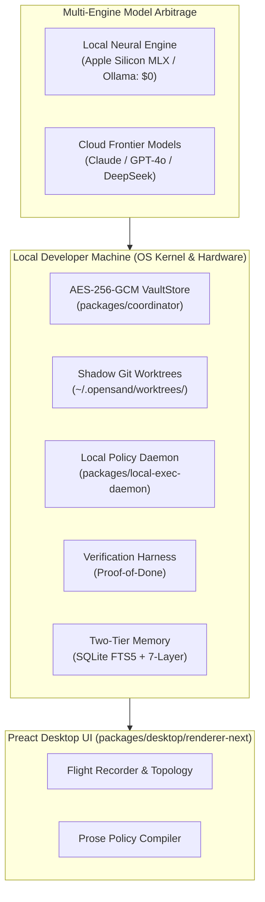
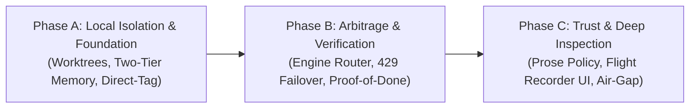

# OpenSand Outstanding App Vision: The Local-First Autonomous Agent App

**Author:** Ada (AI Systems Architect)  
**Date:** 2026-11-26  
**Status:** Proposal & Product Strategy  
**Target Architecture:** [OpenSand Architecture v2](architecture-v2.md), [OpenSand Next](opensand-next.md), [Step 3 Engine Registry](step3-engine-registry-brief.md), [Step 4 Policy Sandbox](step4-policy-sandbox-brief.md)

---

## 1. Vision Statement

OpenSand is the local-first AI coding-agent app you can safely walk away from. While commercial coding assistants (Claude Code, Cursor, GitHub Copilot, Devin) remain thin wrappers around proprietary cloud APIs that demand constant human vigilance and lock users into single-vendor token pricing, OpenSand operates as an autonomous, on-device execution harness. By anchoring agent autonomy in deterministic operating system sandboxing, multi-engine model arbitrage across local neural engines and cloud providers, isolated git worktree time-travel, and tamper-evident local verification proofs, OpenSand guarantees that your code never leaks, malicious agent actions cannot escape OS-level bounds, and tasks are declared complete only when real, independent tests pass on your machine.

---

## 2. Concrete Architectural Differentiators

The following 8 differentiators leverage OpenSand’s unique local-first, multi-engine architecture. Each feature is structurally difficult or impossible for cloud-only competitors to replicate.

---

### Differentiator 1: Zero-Trust Multi-Engine Arbitrage & Cascade Routing
- **What it is:** A multi-tier execution planner that decomposes every coding task across engines based on capability and cost:
  1. *Discovery & Indexing Phase:* Dispatches AST exploration, grep/glob search, symbol extraction, and unit test generation to free, zero-latency local models (e.g., local OpenCode, MLX, or Ollama Qwen-2.5-Coder 14B/32B).
  2. *Synthesis Phase:* Sends only the compacted, high-signal context slice to a frontier cloud model (Claude 3.5 Sonnet, GPT-4o) to generate candidate diffs.
  3. *Verification & Mutation Phase:* Uses local models and local test runners to fuzz, verify, and check mutations on the patch.
  4. *Automatic 429 Quota Failover:* If a cloud engine encounters HTTP 429 rate limits or token exhaustion, execution seamlessly cascades to alternative registered drivers without dropping session context.
- **Why cloud-only competitors can't easily match:** SaaS tools (Cursor, Copilot, Claude Code) operate on unified subscription or markup models where they are commercially incentivized to route tokens through their own hosted proxies. They cannot arbitrate across local Apple Silicon hardware, rival developer CLIs, and competing LLM endpoints without cannibalizing their business model or violating cloud vendor partnerships.
- **How it builds on OpenSand architecture:** Directly extends `packages/coordinator/src/engines/` (`DriverRegistry`, `ENGINE_VERSIONS` pin matrix, and `ENGINES` capability matrix from Step 3 brief), `packages/coordinator/src/router.ts`, and `packages/coordinator/src/errors.ts` (the 429 failover recovery engine from Step 2 brief).
- **Size:** `M`
- **Concrete risk & failure mode:** Different model families exhibit disparate prompt sensitivity and tool-calling schemas (e.g. Anthropic XML blocks vs OpenAI function calling vs raw CLI markdown). Without robust prompt-normalizing adapters in `packages/coordinator/src/engines/`, multi-engine handoffs can degrade reasoning consistency.

---

### Differentiator 2: Hardware-Enforced Air-Gap Isolation & Zero-Egress Vault
- **What it is:** An enforceable security guarantee allowing developers in defense, fintech, healthcare, and proprietary enterprise environments to run AI coding agents with zero data exfiltration risk. The user can toggle an "Air-Gap Safe" mode where network sockets are severed at the OS kernel level (`sandbox-exec` / seatbelt on macOS, bubblewrap / network namespaces on Linux). API credentials and environment secrets stored in OpenSand’'s AES-256-GCM vault are injected as ephemeral process descriptors directly into subagents, completely scrubbed from disk logs, telemetry, and model prompt context.
- **Why cloud-only competitors can't easily match:** Cloud coding agents require streaming prompts, repository contents, and tool outputs over the public internet to remote cloud servers. Even "enterprise zero-retention" cloud offerings still transit external networks. OpenSand can execute end-to-end on air-gapped laptops without a single external byte emitted.
- **How it builds on OpenSand architecture:** Anchored in `packages/local-exec-daemon/src/sandbox/macos-profile.ts` and `linux-profile.ts`, `packages/coordinator/src/vault-store.ts` (AES-256-GCM encrypted credential vault), and `packages/coordinator/src/token-hygiene.ts` (zero-leak secret scrubbing).
- **Size:** `M`
- **Concrete risk & failure mode:** Apple has officially deprecated macOS `sandbox-exec` (Seatbelt) in favor of modern App Sandbox entitlements, meaning future macOS kernel updates could deprecate command-line seatbelt profiles, requiring OpenSand to maintain a fallback loopback firewall proxy.

---

### Differentiator 3: Isolated Shadow Git Worktrees with Instant Time-Travel
- **What it is:** Every autonomous agent task, experimental refactor, or multi-turn job executes in an isolated shadow git worktree (`~/.opensand/worktrees/<session-id>/`). Before and after each tool call, OpenSand captures lightweight git checkpoints. Developers can inspect, test, and run the agent's code in complete isolation from their working branch. The desktop UI provides a timeline slider allowing developers to instantly scrub back to any step, view visual diffs, and branch alternative solution paths without dirtying their working tree or index.
- **Why cloud-only competitors can't easily match:** In-editor plugins (Cursor, Cline, Copilot Workspace) edit files directly in the user's active workspace, risking editor buffer conflicts, unsaved state corruption, and accidental commits if an agent makes destructive changes. Cloud container agents (Devin) incur massive network latency syncing large repos back and forth. OpenSand leverages local APFS/ext4 copy-on-write speed.
- **How it builds on OpenSand architecture:** Resolves open item §2.2 from `opensand-open-items-audit.md` by elevating the battle-tested lifecycle scripts in `scripts/worktree.sh` into a first-class coordinator service: `packages/coordinator/src/workspace-sentinel.ts` and `docs/design/timeline-fork.md`.
- **Size:** `L`
- **Concrete risk & failure mode:** Massive repositories with huge untracked artifacts, embedded binaries, or monolithic `node_modules` can consume excessive disk space or slow down worktree creation if strict disk-space checks (`scripts/lib/free-space.sh`) and automatic worktree pruning routines are not enforced.

---

### Differentiator 4: Independent "Proof-of-Done" Verification Harness
- **What it is:** The foundational requirement for "the agent app you can walk away from." OpenSand rejects model self-certification ("I have completed all tasks"). Instead, a task is only marked `DONE` when an external, non-LLM verification harness passes. The harness compiles the project, runs tests for touched packages, evaluates linter and type-checker invariants, runs adversarial mutation tests, and cryptographically signs a `verification-receipt.json` certifying proof of correctness.
- **Why cloud-only competitors can't easily match:** Cloud agents lack access to the developer's native hardware toolchains, local database containers, proprietary compiler toolchains, and hardware emulators. Emulating these environments in cloud VMs is slow, brittle, and expensive. OpenSand runs verification directly against the developer's native environment.
- **How it builds on OpenSand architecture:** Integrates `packages/coordinator/src/coordinator.ts` (`TurnRunner` lifecycle), `packages/local-exec-daemon/src/policy-engine.ts` (sandboxed deterministic test execution), and `packages/protocol` (standardized verification receipt schema).
- **Size:** `M`
- **Concrete risk & failure mode:** Flaky tests, slow end-to-end integration suites, or broken pre-existing baseline tests can trap the agent in an infinite fix-verify loop. The harness must implement strict change-budget gates and baseline regression comparisons before holding the agent accountable.

---

### Differentiator 5: Natural-Language Policy Compiler with Dry-Run Audit ("Prose Policy Rules")
- **What it is:** Developers express operational and security boundaries in plain language (e.g., *"Never touch files in /migrations without interactive confirmation"*, *"Allow reading and grepping inside /src, but deny write access to .env, package.json, and all dotfiles"*). OpenSand compiles these sentences into deterministic regex/path AST rules enforced by `packages/local-exec-daemon`. Before activating a rule, a "Dry-Run Audit" replays the rule against the last 200 historical tool invocations in `~/.opensand/sessions/`, showing the user exactly what commands would have been allowed or blocked.
- **Why cloud-only competitors can't easily match:** Cloud tools enforce policies via LLM system prompt instructions (e.g. *"You are a helpful assistant; please do not edit sensitive files"*), which are vulnerable to prompt injection, semantic jailbreaks, and context-window truncation. OpenSand decouples policy from the LLM, enforcing it deterministically in a native OS daemon.
- **How it builds on OpenSand architecture:** Resolves open item §2.1 from `opensand-open-items-audit.md` and implements the architecture specified in `docs/design/prose-policy-rules.md`, building directly on `packages/local-exec-daemon/src/policy-engine.ts` and `packages/desktop/renderer-next/src/components/ApprovalCard.tsx`.
- **Size:** `M`
- **Concrete risk & failure mode:** Ambiguous natural language prompts could compile into overly aggressive deny rules that cause false-positive execution blocks during autonomous turns, requiring clear dry-run previews and one-click override modals.

---

### Differentiator 6: Two-Tier Memory: SQLite FTS5 Epics + 7-Layer Scoped Facts
- **What it is:** An integrated, cross-project memory architecture that unifies OpenSand's read-only developer memory (`~/.memory/memo.db` with SQLite + FTS5 full-text indexing) with its structured 7-layer JSON memory store (`~/.opensand/memory/`) and automated habit extractor (`habit-extractor.ts`). The agent learns cross-repo developer patterns (e.g. preferred testing frameworks, coding conventions, architectural decisions, and previous bug fixes across any local repo on the machine) and injects only highly ranked, relevant memories into the context pack.
- **Why cloud-only competitors can't easily match:** Cloud assistants are walled off inside specific SaaS accounts, individual GitHub repositories, or isolated tenant workspaces. They cannot inspect machine-wide development habits across personal projects, legacy codebases, and terminal sessions without infringing on privacy boundaries.
- **How it builds on OpenSand architecture:** Resolves open item §1.1 from `opensand-open-items-audit.md` by unifying `packages/coordinator/src/memo-store.ts`, `packages/coordinator/src/memory-store.ts`, and `packages/coordinator/src/habit-extractor.ts` into a cohesive memory subsystem.
- **Size:** `S`
- **Concrete risk & failure mode:** SQLite write contention during parallel multi-agent sessions, or memory bloat that injects stale or contradictory past conventions into new project prompts.

---

### Differentiator 7: Visual Execution Topology & Interactive Diff Approval (Flight Recorder)
- **What it is:** A specialized desktop inspection view in `packages/desktop/renderer-next`. Rather than a standard chat log, developers get an interactive, real-time Flight Recorder:
  1. *Causal Execution DAG:* Visualizes agent tool dependencies, subprocess lifecycles, and subagent forks.
  2. *Live Blast Radius Heatmap:* Displays file read/write access frequencies and process activity within the local execution daemon.
  3. *Side-by-Side AST Diff & Inline Mutation:* When an approval is required (`ask` or `auto_edit`), the user is presented with a rich syntax-highlighted diff viewer that allows in-place user adjustments directly in the card before execution resumes.
- **Why cloud-only competitors can't easily match:** Terminal-based coding CLIs (Claude Code, Aider) are constrained by ANSI escape sequences and terminal window limitations. Web-based SaaS agents cannot stream real-time local OS process trees and kernel file access events at sub-millisecond latency.
- **How it builds on OpenSand architecture:** Builds directly on `packages/desktop/renderer-next` (Preact UI shell), `packages/desktop/src/ipc-bridge.ts`, and the PR #247 inline approval card architecture.
- **Size:** `M`
- **Concrete risk & failure mode:** High-frequency IPC streaming during large filesystem scans (`glob`/`grep`) can flood the Electron renderer thread, causing UI stutters unless throttled and windowed via virtualized lists.

---

### Differentiator 8: Zero-Network Offline Mode with Hardware Quantization
- **What it is:** Full-featured, offline-first agentic coding that operates without an internet connection. OpenSand leverages local hardware acceleration (Apple Silicon Metal Performance Shaders / MLX on macOS, ROCm/CUDA on Linux) to execute local LLM weights (e.g. Qwen 2.5 Coder, DeepSeek-Coder, Llama 3.3). The coordinator uses deterministic grammar sampling (BNF / JSON Schema enforcement) to ensure 100% syntactically valid tool calling even with compact 8B–14B models.
- **Why cloud-only competitors can't easily match:** Cursor, GitHub Copilot, and Claude Code are completely unusable offline on planes, remote sites, or secure facilities because their core inference pipelines depend on continuous cloud connectivity.
- **How it builds on OpenSand architecture:** Integrates `packages/coordinator/src/engines/` (`OpenAIDriver` and `CustomAcpDriver` connected to localhost endpoints), `packages/desktop/src/desktop-server.ts` engine detection, and Step 3 driver architecture.
- **Size:** `S`
- **Concrete risk & failure mode:** Smaller local models (8B–14B) have shorter effective attention spans and can hallucinate complex multi-step refactor plans compared to frontier models, requiring tighter turn budgets and strict schema constraints.

---

## 3. Considered and Rejected

To maintain strategic clarity and avoid sprawling scope, the following tempting ideas were evaluated and deliberately rejected:

| Rejected Concept | Why It Sounds Attractive | Architectural Reality & Rejection Rationale |
|---|---|---|
| **Full IDE / VS Code Fork** (Competing directly with Cursor) | Complete control over editor UI, syntax highlighting, and inline tab completion. | **Rejected:** Massive maintenance overhead. Upstream VS Code updates constantly break forks, and developers resist abandoning their customized editor setups. OpenSand wins as an autonomous companion app and orchestrator that commands external editors and native toolchains via standard protocols. |
| **Hosting Proprietary Model Weights / SaaS LLM Provider** | Monetizing token markups and building proprietary model moats. | **Rejected:** OpenSand is an open, client-side execution harness, not a foundation model research lab. Competing with Anthropic, Google, and OpenAI on pre-training capital is a losing proposition. OpenSand’'s strength is vendor independence and multi-engine arbitrage. |
| **Centralized Cloud Workspace Sync / SaaS Relay** | Allowing developers to share sessions across devices via a hosted cloud server. | **Rejected:** Violates the fundamental local-first security premise. Transmitting unencrypted local codebases, session traces, and environment variables to a central SaaS server re-introduces data exfiltration risks and single-point-of-failure liabilities. Peer-to-peer or git-based remotes are the appropriate model. |
| **Unconstrained Autonomous Web Browsing / Headless Chrome Agent** | Allowing the agent to crawl the live web to research documentation and troubleshooting forums. | **Rejected:** Exposes the developer’'s local system to indirect prompt injection from adversarial web pages, tracking scripts, and bloat. Web research should be sandboxed to read-only markdown scrapers and pre-indexed documentation caches. |

---

## 4. Priority Roadmap Across the Next 3 Phases

To deliver these differentiators methodically without thrashing, implementation is staged across 3 sequential phases:

### Phase A: Local Isolation & Foundational Substrate (Immediate Milestone)
*Goal: Provide unbreakable sandbox isolation, unified local memory, and rapid release velocity.*
1. **Shadow Git Worktree Management (`packages/coordinator` & `packages/local-exec-daemon`):** Implement `~/.opensand/worktrees/<session-id>/` lifecycle, automatic branch isolation, and copy-on-write snapshotting (Differentiator 3; resolving audit item §2.2).
2. **Two-Tier Memory Unification (`packages/coordinator`):** Wire `memo-store.ts` (SQLite FTS5) with `memory-store.ts` (7-layer JSON) and `habit-extractor.ts` to surface cross-project episodic context in agent prompts (Differentiator 6; resolving audit item §1.1).
3. **Step 2 Direct-Tag Release Promotion (`scripts/release.sh` & `.github/workflows/`):** Eliminate the 20–40 minute version-bump PR roundtrip to enable sub-5-minute release deployments.

### Phase B: Multi-Engine Arbitrage & Verification Engine
*Goal: Enable cost-effective, multi-engine routing with tamper-evident proof of correctness.*
1. **Multi-Engine Arbitrage & 429 Cascade Router (`packages/coordinator`):** Implement task-tier dispatching (local models for exploration/test generation, frontier models for synthesis) with automatic 429 fallback handling (Differentiator 1).
2. **Autonomous Proof-of-Done Verification Harness (`packages/coordinator` & `packages/protocol`):** Enforce hermetic compile, test, and linting checks with cryptographically hashed `verification-receipt.json` outputs before any task is marked complete (Differentiator 4).
3. **Step 3 Pluggable Driver Registry (`packages/coordinator/src/engines/`):** Land dedicated drivers for Claude, OpenCode, OpenAI-compatible, and local MLX/Ollama endpoints.

### Phase C: Verifiable Trust & Desktop Inspection Experience
*Goal: Provide plain-language safety controls and deep visibility into agent execution.*
1. **Prose Policy Rules Compiler & Dry-Run Engine (`packages/local-exec-daemon`):** Natural-language policy authoring with historical session audit replay (Differentiator 5; resolving audit item §2.1 and `prose-policy-rules.md`).
2. **Visual Flight Recorder & Topology DAG (`packages/desktop/renderer-next`):** Real-time execution DAG, process blast-radius visualization, and interactive AST diff approval (Differentiator 7).
3. **Hardware Air-Gap Safe Profiles (`packages/local-exec-daemon/src/sandbox/`):** OS-level zero-egress enforcement with ephemeral secret injection from `VaultStore` (Differentiator 2).
