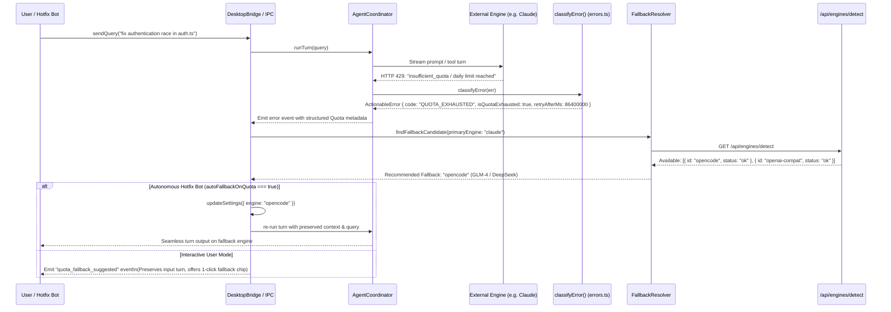

# Step 2 Direct-Tag Release & Quota Recovery Implementation Brief

**Author:** Ada (AI Systems Architect)  
**Date:** 2026-11-25  
**Status:** Decided & Build-Ready (Execution Brief for Atlas and Rigel)  
**Parent Architecture:** [OpenSand Architecture v2](architecture-v2.md) §4.1–4.2 & §3

---

## 1. Executive Summary & Context

Under OpenSand Architecture v2 ([OpenSand Architecture v2](architecture-v2.md) §4), the hotfix lifecycle is bound to a strict 120-minute maximum budget from defect report to verified production confirmation:
`report (10m)` → `fix (40m)` → `verify (15m)` → `merge (15m)` → `release (20m)` → `install (10m)` → `confirm (10m)`.

In the current infrastructure, two acute architectural failure modes threaten this budget:
1. **§4.2(b) Standalone Version-Bump PR Roundtrip (+20–40 min latency):** `scripts/release.sh:107-209` opens an ad-hoc `chore/bump-v<version>` PR, pushes it to GitHub, waits for GitHub Actions CI, runs `scripts/pr-gate.sh`, and handles stale base rebases before a release tag can even be created. Once merged, `.github/workflows/release.yml` rebuilds and recompiles all binaries from scratch on the tag event, duplicating 20–40 minutes of CI and rebase delay.
2. **§4.2(e) Engine 429 & Quota Lockout (+30–60 min stall):** When an AI model provider rate limits or exhausts account token credits during hotfix creation or turn execution, `packages/coordinator/src/errors.ts:36-88` logs a generic message and terminates the turn. The agent context is dropped, requiring manual user intervention to reconfigure engines in Settings and reconstruct conversational state from scratch.

This specification details the architectural resolution for both items and establishes two non-overlapping builder PR briefs for Atlas and Rigel.

---

## 2. Direct-Tag Release Promotion Architecture (§4.2(b))

```mermaid
flowchart TD
    subgraph CurrentRelease["Current Release Pipeline (20-40m Latency)"]
        RelScript1["scripts/release.sh"] -->|create branch| BumpBranch["chore/bump-v0.1.19"]
        BumpBranch -->|open PR| BumpPR["gh pr create"]
        BumpPR -->|wait CI| GateWait["pr-gate.sh wait (10-15m)"]
        GateWait -->|stale base?| RebaseWait["rebase & re-run CI (10-15m)"]
        RebaseWait -->|merge| MergedMain["Merged to main"]
        MergedMain -->|push tag| TagPush1["git push origin v0.1.19"]
        TagPush1 -->|trigger| RelYml1["release.yml rebuilds everything (15-20m)"]
    end

    subgraph DirectTagRelease["Target Direct-Tag Architecture (< 5m Promotion)"]
        MainCommit["Push / Merge to main"] -->|CI triggers| CiYml["ci.yml (Build & Test Matrix)"]
        CiYml -->|Package macOS & Linux| StagedArtifacts["Upload Workflow Artifacts\n(opensand-mac-0.1.19, opensand-linux-0.1.19)"]
        
        RelScript2["scripts/release.sh <ver>"] -->|Pre-release checks| LocalTag["git tag v0.1.19 && git push origin v0.1.19"]
        LocalTag -->|Tag Push| RelYml2["release.yml (Tag Promotion Job)"]
        
        RelYml2 -->|Download Staged Artifacts| StagedArtifacts
        RelYml2 -->|Verify Checksums & Info.plist| VerifiedAssets["Verified Binaries"]
        RelYml2 -->|Provenance & Smoke Check| GatePassed["provenance-gate.sh & smoke-linux.sh"]
        GatePassed -->|Publish Assets Directly| GhRelease["GitHub Release Published"]
    end
```



### 2.1 Continuous Artifact Staging on `main`

Instead of delaying binary compilation until release tagging, `.github/workflows/ci.yml` is augmented to package and stage release artifacts on every verified merge to `main`:
- The macOS job packages `.dmg` and `.zip` bundles using `pnpm package:mac`.
- The Linux job packages `.AppImage` and `.deb` bundles using `pnpm package:linux`.
- Cryptographic SHA256 hashes are computed and saved to `SHA256SUMS.txt`.
- Artifacts are uploaded via `actions/upload-artifact@v4` with a retention policy of 7 days, tagged with the commit SHA (`opensand-binaries-${{ github.sha }}`).

### 2.2 Direct Tag Promotion in `.github/workflows/release.yml`

When a release tag `v*.*.*` is pushed:
1. `release.yml` resolves the underlying commit SHA on `origin/main`.
2. It queries GitHub Actions via `actions/download-artifact@v4` (or `gh run download --commit <sha>`) for the pre-built staging artifacts.
3. **Artifact Integrity Verification:**
   - Computes SHA256 of downloaded binaries against `SHA256SUMS.txt`.
   - Runs `Info.plist` bundle version verification (`CFBundleShortVersionString` and `CFBundleVersion` must equal `<version>`).
   - Executes `bash scripts/provenance-gate.sh` to ensure zero unapproved binary mutations.
   - Executes `bash scripts/smoke-linux.sh dist/release/*.deb` in headless Xvfb.
4. **Instant Asset Publishing:** Uploads the verified binaries directly to the GitHub Release using `softprops/action-gh-release@v2`.
5. **Fallback:** If staged artifacts are absent (e.g. tag applied to an external or untracked commit), the job falls back to in-situ compilation while emitting a clear warning in the build summary.

### 2.3 Refactoring `scripts/release.sh`

Lines 107–209 of `scripts/release.sh` are refactored:
- Steps 2 and 3 (the `chore/bump-v<version>` branch creation, PR creation, CI wait loop, and rebase polling) are completely excised.
- Pre-release assertions check that:
  1. The working directory is clean and corresponds to `origin/main`.
  2. Local `package.json` and package sub-manifests match `<version>` (or are synced via `node scripts/sync-versions.js <version>` in the developer branch prior to main merge).
  3. `scripts/release-check.sh` passes locally.
- Creates and pushes tag `v$VERSION` directly: `git tag -a "v$VERSION" -m "Release v$VERSION" && git push origin "v$VERSION"`.
- Polls the promoted GitHub Release asset URL, reducing total release stage time from 25–45 minutes down to < 5 minutes.

---

## 3. Engine 429 & Quota Lockout Recovery Architecture (§4.2(e))



### 3.1 Structured Error Classification in `packages/coordinator/src/errors.ts`

Lines 36–88 of `packages/coordinator/src/errors.ts` are upgraded to distinguish between transient concurrency rate limits and persistent quota/credit exhaustion:

```typescript
export interface ActionableError {
  code:
    | "AUTH_FAILED"
    | "RATE_LIMIT_EXCEEDED"
    | "QUOTA_EXHAUSTED"
    | "SERVICE_DOWN"
    | "CONTEXT_LENGTH_EXCEEDED"
    | "POLICY_DENIED";
  cause: string;
  nextAction: string;
  isUserFixable: boolean;
  statusCode?: number;
  rawMessage?: string;
  retryAfterMs?: number;
  resetAt?: number;
  isQuotaExhausted?: boolean;
  failedEngineId?: string;
}
```

- **Transient 429:** When `retryAfterMs` is small (< 60 seconds) and error message indicates concurrency throttle (`rate limit`, `too many requests`), returns `code: "RATE_LIMIT_EXCEEDED"`, enabling client-side exponential backoff without switching models.
- **Quota Lockout:** When `resetAt` is distant (> 5 minutes), status is 429/402, or error string matches `quota exceeded`, `insufficient_quota`, `credit balance`, returns `code: "QUOTA_EXHAUSTED"` with `isQuotaExhausted: true`.

### 3.2 Dynamic Fallback Resolution (`FallbackResolver`)

A new module `packages/coordinator/src/engines/fallback-resolver.ts`:
- Consumes available engine catalogs from `GET /api/engines/detect` (or `DriverRegistry`).
- Evaluates candidate engines based on:
  1. Authentication status (`detection.hasApiKey === true` or valid local binary).
  2. Provider independence (e.g. if Anthropic Claude exhausts quota, select OpenCode, DeepSeek, or OpenAI; avoid secondary models on the same failed provider account).
  3. Capability parity (requires `resume` and sufficient context length).
- Emits structured recommendation: `{ primaryEngine: string; candidateEngine: string; fallbackModel?: string; reason: string }`.

### 3.3 Turn Context Preservation in `DesktopBridge`

In `packages/desktop/src/ipc-bridge.ts:810-835`:
- When `classifyError()` returns `isQuotaExhausted: true`:
  - The in-flight turn messages, tool call history, and user query are snapshotted in session memory (`preserveTurnContext()`).
  - If the agent is operating under autonomous hotfix policy (`autoFallbackOnQuota: true` or bot role is hotfix):
    1. Logs: `Quota exhausted on ${failedEngine}. Automatically switching to fallback engine ${fallbackEngine}.`
    2. Switches active session engine to the fallback candidate.
    3. Re-dispatches `runTurn()` with preserved context, resuming turn execution without developer delay.
  - If operating in interactive user mode:
    1. Emits event `quota_fallback_suggested` containing `{ primaryEngine, fallbackEngine, preservedQuery }`.
    2. Desktop UI renders an inline action chip: `[Switch to OpenCode & Continue]` allowing instant turn completion in one tap without navigating to Settings.

---

## 4. Failure Modes & Invariants Matrix

| Failure Mode | Trigger Condition | System Mitigation | Preserved Invariant |
| --- | --- | --- | --- |
| **Missing CI Artifact on Tag** | Tag pushed to ad-hoc commit where `ci.yml` didn't finish | `release.yml` falls back to compilation runner with prominent warning | Release asset delivery completes; provenance check still runs. |
| **Info.plist Version Mismatch** | App bundle `CFBundleVersion` does not match release tag | `release.yml` and `release.sh` abort before asset publication | Zero broken or mismatched versions released to users. |
| **All Configured Engines 429** | Both primary and secondary fallback providers exhausted | `FallbackResolver` returns null candidates; error surfaces with clear recharge link | System fails gracefully with plain error; never loops infinitely. |
| **Stale Transcript during Fallback** | Swapping engine mid-turn corrupts turn sequence | Snapshot preserves conversation messages up to the failed turn boundary | History integrity maintained; no duplicate assistant responses. |

---

## 5. Builder Work Breakdown Structure (Atlas & Rigel)

Implementation of Step 2 is partitioned into two strictly non-overlapping builder PR briefs executing in parallel.

### Brief 2A: Direct-Tag Release Pipeline & Bump PR Elimination
- **Assignee:** Atlas (AI Deployment & Infrastructure Operations Manager)
- **Goal:** Eliminate the 20–40 min version-bump PR cycle in `scripts/release.sh`, update `ci.yml` to stage release binaries on `main`, update `release.yml` to promote staged artifacts upon tag push, and keep all provenance, Info.plist, and smoke checks intact.
- **File Allow-List (Strictly No Overlap):**
  - `scripts/release.sh` (EDIT: remove steps 2 & 3, add pre-release checks and direct tag push)
  - `scripts/release-check.sh` (EDIT: validate tag promotion preflight)
  - `.github/workflows/release.yml` (EDIT: download staged artifacts from commit, promote to release)
  - `.github/workflows/ci.yml` (EDIT: stage release artifacts and checksums on main merge)
  - `scripts/test/release-direct-tag.test.sh` (NEW: hermetic test simulating direct-tag flow)
- **Done When:**
  1. `bash scripts/release-check.sh` and `bash scripts/test/release-direct-tag.test.sh` pass.
  2. `scripts/release.sh --dry-run <version>` runs end-to-end without attempting to create a git branch, open a PR, or invoke `pr-gate.sh`.
  3. `Info.plist` bundle version checks, SHA256 checksum generation, `provenance-gate.sh`, and `smoke-linux.sh` remain verified gates.

### Brief 2B: Engine 429 Quota Error Resilience & Turn-Preserving Fallback
- **Assignee:** Rigel (QA & Release Engineer)
- **Goal:** Upgrade `packages/coordinator/src/errors.ts` to classify quota exhaustion, implement `FallbackResolver` querying `/api/engines/detect`, and wire `DesktopBridge` to preserve turn context and execute seamless engine fallback.
- **File Allow-List (Strictly No Overlap):**
  - `packages/coordinator/src/errors.ts` (EDIT: parse provider quota signals, add QUOTA_EXHAUSTED code)
  - `packages/coordinator/src/engines/fallback-resolver.ts` (NEW: candidate ranking and discovery)
  - `packages/coordinator/src/types.ts` (EDIT: add QuotaFallbackEvent and ActionableError fields)
  - `packages/desktop/src/ipc-bridge.ts` (EDIT: handle QUOTA_EXHAUSTED, preserve context, auto-switch)
  - `packages/desktop/src/desktop-server.ts` (EDIT: surface fallback candidate metadata on errors)
  - `packages/coordinator/test/provider-error-handling.test.ts` (EDIT: test 429 quota classification)
  - `packages/desktop/test/engine-quota-recovery.test.ts` (NEW: test context preservation and auto-fallback)
- **Done When:**
  1. `pnpm --filter @opensand/coordinator test` and `pnpm --filter @opensand/desktop test` pass.
  2. `provider-error-handling.test.ts` proves that `classifyError()` accurately categorizes Anthropic, OpenAI, and OpenCode quota exhaustion as `QUOTA_EXHAUSTED` with `isQuotaExhausted: true`.
  3. `engine-quota-recovery.test.ts` verifies that when an active engine receives 429 quota exhaustion, `DesktopBridge` captures the query, resolves an alternative configured engine, and resumes without dropping conversational state.
