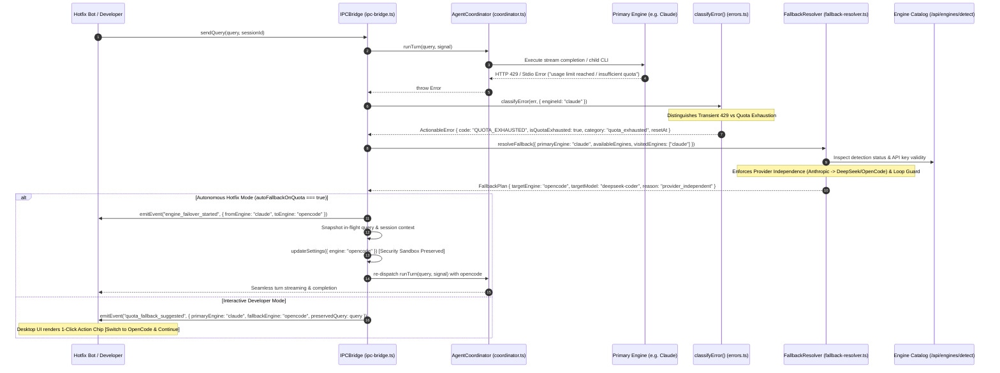

# Step 2b Automated 429 Quota Error Classification & Instant Fallback Switching Implementation Brief

**Author:** Ada (AI Systems Architect)
**Date:** 2026-11-26
**Status:** Decided & Build-Ready (Execution Brief for Dex)
**Parent Architecture:** [OpenSand Architecture v2](architecture-v2.md) §3 & §4.2(e), [Step 2 Direct-Tag Release Brief](step2-release-direct-tag-brief.md), [Step 3 Pluggable Driver Architecture Brief](step3-engine-registry-brief.md)

---

## 1. Executive Summary & Context

Under OpenSand Architecture v2 ([OpenSand Architecture v2](architecture-v2.md) §4.1–4.2), the hotfix lifecycle is bound to a strict 120-minute maximum budget from defect report to verified production confirmation:
`report (10m)` → `fix (40m)` → `verify (15m)` → `merge (15m)` → `release (20m)` → `install (10m)` → `confirm (10m)`.

In Architecture v2 Step 2 item 5 ([OpenSand Architecture v2](architecture-v2.md) §4.2(e)), engine quota lockouts and HTTP 429 rate limits are identified as severe operational risks capable of stalling an autonomous hotfix loop or interactive developer session for 30–60 minutes.

Currently, the error handling pipeline suffers from three major architectural deficiencies:
1. **Lumped 429 Error Classification:** `packages/coordinator/src/errors.ts:37-88` categorizes all HTTP 429 responses under a single generic `RATE_LIMIT_EXCEEDED` code, regardless of whether the error is a transient concurrency throttle (`retryAfterMs < 60s`) or a catastrophic account quota exhaustion (`resets in 24 hours` / zero credit balance).
2. **Context Dropping & Missing Failover:** In `packages/desktop/src/ipc-bridge.ts:810-835`, encountering an engine failure terminates the turn immediately. While an ad-hoc fallback exists for auth failures (`isAuthFailure` silently switches `this.settings.engine` to `opensand`), the in-flight query, tool invocation context, and message history are abandoned. For quota errors, no fallback occurs at all.
3. **No Fallback Ladder or Cycle Prevention:** There is no declarative fallback ladder (e.g. Primary Claude → Secondary OpenCode/DeepSeek → OpenAI/Gemini → Local Ollama/OpenSand), no provider-independence enforcement (failing from Claude Sonnet to Claude Haiku on the same exhausted Anthropic account fails identically), and no cycle guard to prevent infinite fallback oscillations.

This specification establishes the target architecture for automated 429 quota error classification, provider-independent fallback ladders, loop guards, turn context preservation, and security invariants. It provides a non-overlapping, build-ready implementation brief for Dex.

---

## 2. Codebase Audit: Current 429 Classification & Error Breakage Sites

A comprehensive audit of `origin/main` reveals the exact symbols and lines governing turn errors, 429 rate limits, and engine execution:

| Source File & Line | Current Behavior | Limitation & Architectural Defect |
| --- | --- | --- |
| `packages/coordinator/src/errors.ts:14-17` (`isAuthFailure`) | Regex match on error strings: `/is not signed in\|...\|401\|invalid api key/i`. | Checks only auth strings; completely ignores quota exhaustion, billing lockouts, and rate limits. |
| `packages/coordinator/src/errors.ts:19-27` (`interface ActionableError`) | Defines `{ code, cause, nextAction, isUserFixable, statusCode, rawMessage, retryAfterMs }`. | Missing critical metadata fields: `category`, `isQuotaExhausted`, `resetAt`, and `failedEngineId`. |
| `packages/coordinator/src/errors.ts:37-88` (`classifyError`) | Matches status 429 or strings `rate limit` / `quota exceeded`. Checks `resetAt`. | Always returns `code: "RATE_LIMIT_EXCEEDED"`. Fails to set `isQuotaExhausted: true` or distinguish transient concurrency throttling from daily quota exhaustion. |
| `packages/coordinator/src/errors.ts:90-105` (`classifyError`) | Matches status 402, `insufficient credits`, `payment required`. | Returns `code: "INSUFFICIENT_CREDITS"`, but lacks `isQuotaExhausted: true` flag needed by automated failover systems. |
| `packages/coordinator/src/llm-client.ts:18-50` (`ProviderError`) | Captures `status`, `statusCode`, `code`, `retryAfterMs`, `resetAt`, `endpoint`, `upstreamDetail`. | Rich structured telemetry is captured at HTTP client layer but partially discarded by `classifyError`. |
| `packages/coordinator/src/llm-client.ts:664-681` (`UniversalLLMClient`) | Throws `ProviderError` on 429 with `retryAfterMs` and `rateResetAt`. | Client retries transient network errors, but when 429 persists or quota is dead, error bubbles unhandled to turn runner. |
| `packages/coordinator/src/engines/external-engine-runner.ts:294-306` (`ExternalEngineTurnRunner.runTurn`) | Parses CLI child process failure output for `/usage limit\|rate limit\|quota/i`. | Extracts `resetAt` and throws formatted string `Claude usage limit reached, resets at ...`. Discards structured error code. |
| `packages/coordinator/src/coordinator.ts:680-760` (`AgentCoordinator.runExternalEngineTurn`) | Invokes `runner.runTurn()`, catches error, flushes `transcript.writeProjections()`, and rethrows. | Does not classify error or attempt fallback at coordinator level; passes error up to `IPCBridge`. |
| `packages/desktop/src/ipc-bridge.ts:770-785` (`IPCBridge.onTurnEvent`) | Handles `event.type === 'error'` by invoking `classifyError(event.error)` and emitting IPC `error`. | UI receives generic rate limit message with no programmatic fallback hook. |
| `packages/desktop/src/ipc-bridge.ts:810-835` (`IPCBridge.sendQuery`) | Catches rejected `runTurn()` promise. Runs `classifyError(err)`. If `isAuthFailure(err)`, mutates `this.settings.engine = 'opensand'`. | Turn context is dropped; user query is lost; no re-run occurs; quota errors trigger no failover at all. |
| `packages/desktop/src/desktop-server.ts:576` (`GET /api/engines/detect`) | Invokes `ipcBridge.detectEngines()` to return array of `EngineDetectionResult`. | Lists installed engines and credentials, but provides no ranked fallback recommendation. |

---

## 3. Architecture & Failover Sequence

The target quota failover architecture introduces a clear separation of concerns across classification, candidate resolution, and turn recovery:



### 3.1 Taxonomy & Error Classification (`packages/coordinator/src/errors.ts`)

The `ActionableError` interface is expanded to provide unambiguous categorization:

```typescript
export type ErrorCategory =
  | "transient_rate_limit"   // 429 concurrency limit, short retry-after (< 60s)
  | "quota_exhausted"        // Daily/weekly token limit, credit depletion (429/402)
  | "auth_failure"           // Invalid key, forbidden model (401/403)
  | "provider_unavailable"   // 5xx upstream outage, maintenance
  | "context_exceeded"       // Context length limit
  | "client_timeout"         // Turn watchdog or network timeout
  | "system_policy";         // Tool denial or sandbox boundary violation

export interface ActionableError {
  code: string;
  category: ErrorCategory;
  cause: string;
  nextAction: string;
  isUserFixable: boolean;
  statusCode?: number;
  rawMessage?: string;
  retryAfterMs?: number;
  resetAt?: number;
  isQuotaExhausted?: boolean;
  failedEngineId?: string;
}
```

#### Classification Rules:
1. **Transient Rate Limit (`category: "transient_rate_limit"`):**
   - Condition: `status === 429` AND `retryAfterMs` is defined AND `retryAfterMs <= 60_000` (1 minute).
   - Code: `RATE_LIMIT_EXCEEDED`.
   - Behavior: Caller should apply exponential backoff with jitter in-turn. Does *not* trigger engine failover.
2. **Quota Exhaustion (`category: "quota_exhausted"`):**
   - Condition:
     - Status 402 OR
     - Status 429 with `resetAt` > 5 minutes in the future OR
     - Status 429 with `retryAfterMs > 60_000` OR
     - Error payload / text matches regex:
       `/quota exceeded|insufficient_quota|daily limit|credit balance|usage limit reached|exceeded your current quota|resource_exhausted|balance insufficient/i`.
   - Code: `QUOTA_EXHAUSTED`.
   - Flags: `isQuotaExhausted: true`.
   - Behavior: Triggers `FallbackResolver`.
3. **Authentication Failure (`category: "auth_failure"`):**
   - Condition: `status === 401 || status === 403` OR regex `/invalid api key|unauthorized|forbidden|not logged in/i`.
   - Code: `AUTH_INVALID_KEY` or `AUTH_FORBIDDEN`.
   - Flags: `isQuotaExhausted: false`.
   - Behavior: Non-retryable on current credentials; triggers re-authentication prompt or fallback to local engine.

---

### 3.2 Dynamic Fallback Ladder & Candidate Resolution (`packages/coordinator/src/engines/fallback-resolver.ts`)

A dedicated module `packages/coordinator/src/engines/fallback-resolver.ts` manages engine candidate selection:

```typescript
export interface FallbackLadderEntry {
  engineId: string;
  providerFamily: "anthropic" | "openai" | "opencode" | "google" | "local";
  modelPreference?: string;
  priority: number;
}

export interface FallbackResolverOptions {
  primaryEngineId: string;
  availableEngines: EngineDetectionResult[];
  visitedEngines: Set<string>;
  maxHops?: number; // default: 2
  ladder?: FallbackLadderEntry[];
}

export interface FallbackResolution {
  success: boolean;
  targetEngine?: string;
  targetModel?: string;
  reason?: string;
  hopCount: number;
}
```

#### The Provider-Independence Invariant:
If primary engine `claude` (family `anthropic`) fails with `QUOTA_EXHAUSTED`, the resolver **MUST NOT** select another Anthropic model (e.g. `claude-3-5-haiku`) if it shares the same credential account. The ladder prioritizes an independent provider family:
1. Primary: `claude` (Anthropic)
2. Secondary: `opencode` (DeepSeek / GLM-4 via OpenCode CLI or local ACP)
3. Tertiary: `openai-compat` / `openai` (Independent commercial provider)
4. Quaternary: `opensand` (Built-in offline fallback engine)

---

### 3.3 Loop & Cycle Guard Specification

To ensure failover never loops infinitely or thrashes between degraded providers:
1. **Cycle Detection (`visitedEngines`):**
   - Every candidate engine evaluated during a single turn's failover sequence is added to `visitedEngines: Set<string>`.
   - If candidate `E` is already in `visitedEngines`, it is skipped immediately.
2. **Hop Bound (`maxHops = 2`):**
   - A single turn is permitted at most **2 failover hops** (e.g. `claude` → `opencode` → `opensand`).
   - If the hop count reaches `maxHops` and the candidate fails, failover halts and emits a terminal `ActionableError` with actionable user guidance.
3. **Turn Cancellation Immunity:**
   - If the user cancels or aborts the turn (`AbortSignal`), failover resolution terminates instantly without attempting subsequent ladder entries.

---

### 3.4 Turn Context Preservation & Seamless Re-dispatch (`packages/desktop/src/ipc-bridge.ts`)

In `packages/desktop/src/ipc-bridge.ts`:
1. When `runTurn()` catches an error:
   - Call `classifyError(err, { engineId: currentEngine })`.
   - If `actionable.isQuotaExhausted === true`:
     - Capture `inFlightTurn = { query, sessionId, agentId, turnHistory }`.
     - Query `resolveFallback(...)`.
     - If autonomous hotfix mode (`autoFallbackOnQuota === true` or hotfix bot):
       1. Emit `engine_failover_started` event: `{ from: currentEngine, to: targetEngine, reason: actionable.cause }`.
       2. Update active session settings: `this.updateSettings({ engine: targetEngine, model: targetModel })`.
       3. Re-dispatch `coordinator.runTurn(inFlightTurn.query)` using the preserved session messages and transcript.
     - If interactive developer mode:
       1. Emit `quota_fallback_suggested` event: `{ primaryEngine: currentEngine, fallbackEngine: targetEngine, query: inFlightTurn.query }`.
       2. UI renders an inline actionable button: `[Switch to OpenCode & Continue]`.

---

### 3.5 User-Visible Status Event Stream (No Raw Errors)

In accordance with OpenSand user communication guidelines and `scripts/check-raw-errors.sh`:
- **Never expose raw JSON or stack traces:** Raw provider error strings (e.g. `{"error":{"message":"insufficient_quota","type":"insufficient_quota"}}`) are sanitized into plain English:
  - *"Claude daily token quota reached. Automatically switching to OpenCode (DeepSeek) to complete your turn."*
- **Event contract:**
  - Event `engine_failover_started`: `{ fromEngine: string, toEngine: string, reason: string, isAutonomous: boolean }`.
  - Event `quota_fallback_suggested`: `{ primaryEngine: string, fallbackEngine: string, preservedQuery: string }`.

---

### 3.6 Security & Permission Non-Downgrade Invariants

When an automated or interactive engine switch occurs mid-session:
1. **Sandbox Profile Invariant:**
   - The session's `sandboxProfile` (`"read-only" | "workspace-write" | "full"`) must **NEVER** be weakened. If the primary turn operated under `"workspace-write"`, the fallback engine turn must execute under the exact same `"workspace-write"` profile.
2. **Approval Policy Invariant:**
   - The `onApprovalRequired` callback and policy engine decisions (`packages/local-exec-daemon/src/policy-engine.ts`) remain active across failovers. Switching engines cannot bypass user approval prompts.
3. **Credential Redaction Invariant:**
   - Provider API keys stored in `VaultStore` (`packages/coordinator/src/vault-store.ts:69`) are decrypted only in-memory for the active engine. Secrets must never be leaked into failover status events, transcript events, or logs.

---

## 4. Seam Alignment with Step 3 DriverRegistry

In Architecture v2 Step 3 ([Step 3 Engine Registry Brief](step3-engine-registry-brief.md)), engine execution transitions from monolithic `ExternalEngineTurnRunner` to `DriverRegistry` (`packages/coordinator/src/engines/registry.ts`).

To prevent merge friction or architectural collisions:
- **Detection Seam:** In Step 2b, `FallbackResolver` consumes `EngineDetectionResult[]` supplied by `detectEngines()`. In Step 3, `detectEngines()` becomes a facade calling `DriverRegistry.getInstance().detectAll()`. `FallbackResolver` requires zero modifications when Step 3 lands.
- **Execution Seam:** Step 2b implements fallback resolution and context preservation at the `IPCBridge` / `AgentCoordinator` boundary. Step 3 implements driver internals (`ClaudeDriver`, `OpenCodeDriver`). The boundaries are strictly orthogonal and non-overlapping.

---

## 5. Failure Modes & Invariants Matrix

| Failure Mode | Root Cause | Prevention / Architectural Invariant |
| --- | --- | --- |
| **1. Cyclic Failover Thrashing** | Engine A hits quota, switches to B; Engine B fails, switches back to A. | `visitedEngines: Set<string>` strictly forbids re-trying already attempted engines. `maxHops = 2` halts after 2 failed switches. |
| **2. Homogeneous Provider Failover** | Failing from Claude Sonnet to Claude Opus on the same Anthropic API key. | Provider Independence Gate: `FallbackResolver` requires candidate `providerFamily !== failedProviderFamily`. |
| **3. Turn Context Amnesia** | Switching engines drops the user's prompt or multi-turn conversational transcript. | `inFlightTurn` state captures `query`, `messages`, and system prompt; re-dispatches turn on the existing session ID. |
| **4. Permission Downgrade Attack** | Fallback engine uses unconfined execution mode. | Security Invariant: `sandboxProfile` and `toolScopeMode` are copied immutably to the fallback coordinator instance. |
| **5. Transient Throttle Misclassification** | Concurrency spike (HTTP 429, retry-after 2s) triggers an unnecessary model switch. | Error Taxonomy: 429 with `retryAfterMs <= 60_000` is classified as `RATE_LIMIT_EXCEEDED` (retryable in-turn), not `QUOTA_EXHAUSTED`. |
| **6. Secret Leakage in Events** | Error message containing `Bearer sk-ant-...` leaked to UI event stream. | Sanitization pipeline in `classifyError` strips auth headers, bearer tokens, and URLs before emitting status events. |

---

## 6. Builder PR Brief for Dex

Goal: Implement automated 429 quota error classification in `packages/coordinator/src/errors.ts`, dynamic engine fallback resolution in `packages/coordinator/src/engines/fallback-resolver.ts`, and context-preserving failover switching in `packages/desktop/src/ipc-bridge.ts`.

Done when:
1. `pnpm --filter @opensand/coordinator test` and `pnpm --filter @opensand/desktop test` pass green.
2. `packages/coordinator/test/quota-classification.test.ts` proves that 429 quota exhaustion across Anthropic, OpenAI, OpenCode, and Gemini is classified as `QUOTA_EXHAUSTED` with `isQuotaExhausted: true`, while concurrency 429s (< 60s) remain `RATE_LIMIT_EXCEEDED`.
3. `packages/coordinator/test/fallback-resolver.test.ts` proves provider independence, cycle prevention (`visitedEngines`), and hop limits (`maxHops`).
4. `packages/desktop/test/engine-quota-recovery.test.ts` proves that a simulated quota failure in `IPCBridge` automatically resolves an alternative configured engine, preserves turn context, re-runs the turn without data loss, and emits clean status events without raw errors.
5. All verification gates pass: `bash scripts/check-doc-links.sh`, `bash scripts/lessons-index.sh --check`, and `git diff --check origin/main..HEAD`.

Scope:
- Allow-List:
  - `packages/coordinator/src/errors.ts` (EDIT: error taxonomy, `ActionableError`, 429 quota vs transient separation)
  - `packages/coordinator/src/engines/fallback-resolver.ts` (NEW: fallback candidate resolution & loop guard)
  - `packages/coordinator/src/engines/types.ts` (EDIT: export fallback types)
  - `packages/coordinator/src/index.ts` (EDIT: export fallback resolver)
  - `packages/desktop/src/ipc-bridge.ts` (EDIT: wire failover handling, preserve turn context, auto-switch)
  - `packages/coordinator/test/quota-classification.test.ts` (NEW: unit tests for 429 quota classification)
  - `packages/coordinator/test/fallback-resolver.test.ts` (NEW: unit tests for fallback resolver)
  - `packages/desktop/test/engine-quota-recovery.test.ts` (NEW: integration test for turn recovery)
- Strictly Deny-List (Must NOT touch):
  - Do NOT edit `packages/coordinator/src/engines/external-engine-runner.ts` or Step 3 driver files.
  - Do NOT edit `scripts/release.sh` or `.github/workflows/` (reserved for Step 2 Direct-Tag release).
  - Do NOT touch `packages/local-exec-daemon/` (reserved for Step 4).

Report back with:
- PR link, merge commit, test output from coordinator and desktop test suites, and verified proof that 429 quota failure seamlessly resumes the active turn on fallback engine.

### 6.1 Implementation Steps for Dex

1. **Update Error Taxonomy in `packages/coordinator/src/errors.ts`:**
   - Expand `ActionableError` with `category: ErrorCategory`, `isQuotaExhausted?: boolean`, `resetAt?: number`, `failedEngineId?: string`.
   - Update `classifyError(err: unknown, context?: { engineId?: string })`:
     - Inspect status code, `upstreamDetail`, `resetAt`, and regex patterns.
     - Differentiate `transient_rate_limit` (`retryAfterMs <= 60_000`) vs `quota_exhausted`.
     - Assign `code: "QUOTA_EXHAUSTED"` and `isQuotaExhausted: true` when quota/credit limits are hit.
2. **Implement Fallback Resolver in `packages/coordinator/src/engines/fallback-resolver.ts`:**
   - Define `resolveFallback(options: FallbackResolverOptions): FallbackResolution`.
   - Filter `availableEngines` for valid credentials (`hasApiKey` or valid local binary).
   - Enforce provider family independence: if failed engine was Anthropic, pick non-Anthropic candidate.
   - Enforce cycle guard: filter out any candidate present in `visitedEngines`.
   - Enforce hop limit: if `visitedEngines.size >= maxHops`, return `{ success: false, reason: "max_hops_exceeded" }`.
3. **Wire Turn Context Preservation in `packages/desktop/src/ipc-bridge.ts`:**
   - In `sendQuery()` catch handler:
     - Check if `actionable.isQuotaExhausted === true`.
     - Read configured settings (`this.settings`). If hotfix policy or `autoFallbackOnQuota === true`:
       - Resolve fallback candidate via `resolveFallback()`.
       - Emit `engine_failover_started` event.
       - Update active settings: `this.updateSettings({ engine: candidate.targetEngine })`.
       - Re-dispatch `coordinator.runTurn(query, signal)` with preserved session ID.
     - If interactive mode:
       - Emit `quota_fallback_suggested` event.
4. **Author Comprehensive Test Suites:**
   - `packages/coordinator/test/quota-classification.test.ts`:
     - Test OpenAI 429 `insufficient_quota` → `QUOTA_EXHAUSTED`.
     - Test Anthropic 429 `usage limit reached` → `QUOTA_EXHAUSTED`.
     - Test Transient 429 `Retry-After: 5` → `RATE_LIMIT_EXCEEDED` (`isQuotaExhausted: false`).
     - Test 402 `Payment Required` → `INSUFFICIENT_CREDITS` (`isQuotaExhausted: true`).
   - `packages/coordinator/test/fallback-resolver.test.ts`:
     - Test provider independence: primary `claude` resolves to `opencode`, skipping secondary `claude-3-opus`.
     - Test loop guard: visited candidate is never reselected; halts cleanly at `maxHops = 2`.
   - `packages/desktop/test/engine-quota-recovery.test.ts`:
     - Mock primary engine throwing 429 quota exhaustion.
     - Verify `IPCBridge` automatically catches error, invokes fallback resolver, and successfully completes turn on secondary engine.
     - Assert that `sandboxProfile` and tool permissions were preserved unchanged.
