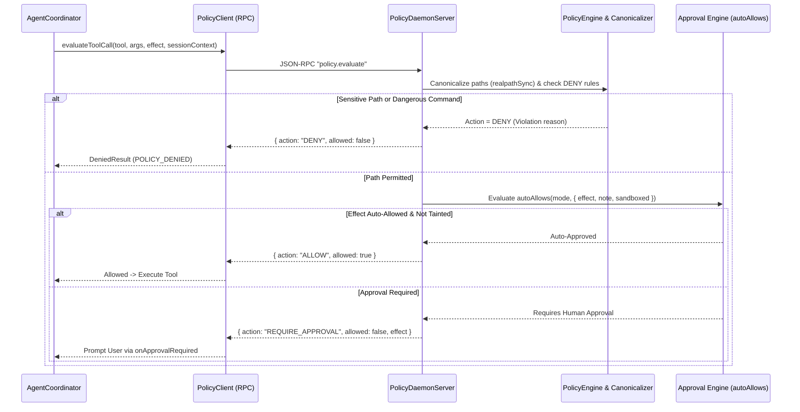

# Step 4 Policy Sandbox Architecture & Builder Implementation Brief

**Author:** Ada (AI Systems Architect)  
**Date:** 2026-11-25  
**Status:** Decided & Build-Ready (Execution Brief for Vega and Dex)  
**Parent Architecture:** [OpenSand Architecture v2](architecture-v2.md) §2.1–2.2 & §3, [Prose Policy Rules](prose-policy-rules.md)

---

## 1. Executive Summary & Context

In OpenSand Architecture v2 ([OpenSand Architecture v2](architecture-v2.md) §2.1–2.2), security boundaries, policy enforcement, and execution orchestration are decoupled across strict boundaries. Step 4 formalizes the execution daemon security architecture, establishing an isolated local policy daemon communicating via structured RPC, enforcing WorkMate-style 3-mode approvals (`ask`, `auto_edit`, `auto`), unifying approval evaluation into a single `autoAllows` function by declared effect, and guaranteeing fail-closed operation across all tool executions.

Currently, security decisions are fragmented across three distinct components:
1. `packages/local-exec-daemon/src/policy-engine.ts` (`:125`): An in-process rule evaluator operating on regex lists and string prefixes.
2. `packages/coordinator/src/coordinator.ts` (`:460-560`): The turn orchestrator, which evaluates policy in-process, checks standing allowlists, gates skill and memory mutations, and prompts for approvals.
3. `packages/desktop/src/ipc-bridge.ts` (`:910-970`): The host desktop bridge, which calls `autoAllows()` and performs duplicated shell safety checks.

This specification audits the existing implementation, identifies remaining architectural gaps, details the IPC boundary protocol and invariants, formalizes the WorkMate-style approval engine, and defines 2 non-overlapping builder PR briefs for Vega and Dex.

---

## 2. Codebase Audit & Gap Analysis

```mermaid
flowchart TD
    subgraph Current["Current State (Fragmented & In-Process)"]
        Coord1["coordinator.ts:461\n(in-process evaluatePolicy)"]
        Coord1 -->|check gates| Coord2["coordinator.ts:480\n(standing allowlist & gates)"]
        Coord2 -->|onApprovalRequired| Bridge1["ipc-bridge.ts:942\n(autoAllows call)"]
        Bridge1 -->|duplicates| RegexCheck["ipc-bridge.ts:915\n(nested shell regex)"]
        Daemon1["policy-engine.ts:174\n(fallback allows unregistered)"]
    end

    subgraph Target["Target Architecture (Step 4 Strict IPC & Effect-First)"]
        CoordTarget["coordinator.ts\n(Turn Orchestrator)"]
        DaemonClient["PolicyDaemonClient\n(JSON-RPC Client)"]
        DaemonServer["PolicyDaemonServer\n(Unix Domain Socket / Stdio RPC)"]
        PolicyCore["PolicyEngine & PathCanonicalizer\n(Fail-Closed, Effect-First)"]
        ApprovalCore["packages/shared/src/approval.ts\n(Single autoAllows Evaluation)"]

        CoordTarget -->|Tool Execution Request| DaemonClient
        DaemonClient -->|Structured RPC| DaemonServer
        DaemonServer --> PolicyCore
        PolicyCore --> ApprovalCore
    end
```



### 2.1 Audit of `packages/local-exec-daemon/src/policy-engine.ts` (`:125`)

- **In-Process Coupling:** `PolicyEngine` is instantiated in-memory by `LocalExecDaemon`. There is no process isolation between the policy evaluation engine and the environment running commands or handling tool payloads. A compromised runner or subagent sharing memory could alter rule structures.
- **Inverted Fallback Logic (`:174-195`):** The fallback evaluator checks tool names (`isReadOnly`, `isExec`, `isWrite`, `isRegistered`) rather than declared effects. In particular, line 184 sets `isRegistered = !['read_file', 'write_file', ...].includes(context.tool)`, causing any tool name not in the list to be allowed by default. This violates the fail-closed invariant.
- **Naive Path Matching (`:256-277`):** Path conditions evaluate via `pathChecked.startsWith(prefix) || pathChecked.includes(prefix)`. This causes false positives (e.g., a file named `my-project/.ssh-notes.md` or `.envrc` is blocked indiscriminately) and critical false negatives (directory traversal like `../../.env` or symlink aliases pointing to `/etc/passwd` escape prefix checks without canonicalization).
- **Missing Default Network Rules:** Egress policy is only evaluated if a rule has `conditions.domains`. There is no default rule permitting normal web search while strictly blocking cloud instance metadata endpoints (`169.254.169.254`, `metadata.google.internal`) and local daemon loopback ports.

### 2.2 Audit of `packages/coordinator/src/coordinator.ts` (`:460-560`)

- **Bypassed `autoAllows` in Coordinator:** The coordinator calls `this.daemon.evaluatePolicy(tc.function.name, args)` at line 461 and computes `needsApproval`. However, `coordinator.ts` never evaluates `autoAllows()`. Instead, it delegates all approval requests to `this.onApprovalRequired(req)`. If `coordinator.ts` is invoked in CLI batch mode or in headless subagent workers with a custom handler, the 3-mode approval logic is bypassed or stalled.
- **Fragmented Taint Tracking:** Coordinator tracks live turn taint (`this.isTainted?.()` at line 483), but taint information is not passed as part of the structured policy evaluation context into `policy-engine.ts`.
- **Modified Arguments Re-check:** While `denyModifiedArgs` (`:524`) validates modified arguments after user edits, this check runs inside coordinator instead of being evaluated through the canonical policy daemon.

### 2.3 Audit of `packages/desktop/src/ipc-bridge.ts` (`:910-970`)

- **Duplicated Policy Inspection:** `ipc-bridge.ts` executes regex checks (`NESTED_SHELL_RE` at `:922`) and inspects dangerous commands in the UI bridge layer. This duplicates logic in `policy-engine.ts` and risks drift between desktop UI and headless CLI executions.
- **Legacy Settings Ambiguity:** `ipc-bridge.ts` checks `this.settings.autoApprove` and `this.settings.autoApprovePersistent` alongside `ApprovalMode` (`ask`, `auto_edit`, `auto`). These legacy boolean flags conflict with the WorkMate 3-mode approval semantics.

---

## 3. Strict Policy Daemon IPC & Boundary Protocol

To enforce strict process and IPC isolation as specified in Architecture v2 §2.1, the policy engine runs as an independent daemon service (`PolicyDaemonServer`) communicating via JSON-RPC 2.0 over a local Unix domain socket (`$OPENSAND_RUN_DIR/policy-daemon.sock`) or dedicated standard I/O pipes.



### 3.1 IPC Message Schema

```typescript
export interface PolicyEvaluateRpcRequest {
  jsonrpc: "2.0";
  id: string | number;
  method: "policy.evaluate";
  params: {
    sessionId: string;
    toolName: string;
    args: Record<string, unknown>;
    declaredEffect?: string;
    approvalMode: "ask" | "auto_edit" | "auto";
    tainted: boolean;
    sandboxed: boolean;
    cwd: string;
    workspaceRoot: string;
  };
}

export interface PolicyEvaluateRpcResponse {
  jsonrpc: "2.0";
  id: string | number;
  result?: {
    action: "ALLOW" | "DENY" | "REQUIRE_APPROVAL";
    allowed: boolean;
    requiresApproval: boolean;
    reason: string;
    canonicalPaths?: string[];
    effect: string;
  };
  error?: {
    code: number;
    message: string;
    data?: unknown;
  };
}
```

### 3.2 Security Boundary Invariants

1. **Invariant 1: Absolute Fail-Closed Default.** Any transport interruption, socket timeout (default 5000ms), unparseable JSON payload, or unknown tool/effect fails closed immediately with `REQUIRE_APPROVAL` (or `DENY` for dangerous paths). Under no circumstances does an error condition default to `ALLOW`.
2. **Invariant 2: Zero LLM Dependencies at Policy Boundary.** Policy evaluation is deterministic, offline, and purely mathematical/algorithmic. Prompt injection, model steering, or manipulated response headers cannot modify rule outcomes or grant tool privileges.
3. **Invariant 3: Canonical Path Sandbox & Traversal Rejection.** All filesystem paths specified in tool arguments (`path`, `filePath`, `cwd`, command line arguments) are canonicalized using `realpathSync` or absolute normalization against `workspaceRoot`. Relative traversals (`../`), symlink redirections outside the workspace boundary, and null-byte injections are rejected with `DENY`.
4. **Invariant 4: Hard Stops for High-Risk Effects (`NEVER_AUTO`).** Tools declaring effects `control` (mouse/keyboard/screen take-over), `spend` (financial transactions/credits), and `self` (modifications to OpenSand source, skills, hooks, or standing rules) MUST ALWAYS require interactive user confirmation regardless of mode (`ask`, `auto_edit`, or `auto`).
5. **Invariant 5: Unsandboxed Shell Isolation.** Any command flagged with `unsandboxed === true` or declaring effect `shell_outside` is treated as a separate security escalation. It is never covered by "always allow" session grants or auto-approval modes.
6. **Invariant 6: Tainted Shell Gate.** When untrusted web content, external connector results, or third-party documentation have been read during the turn session (`tainted === true`), shell execution automatically drops auto-approval and forces interactive human confirmation with clear taint attribution.
7. **Invariant 7: Egress Network Policy.** Outgoing HTTP/HTTPS is enabled by default in `auto` mode for developer tasks, but requests targeting cloud metadata addresses (`169.254.169.254`, `metadata.google.internal`) and local daemon loopback ports (`127.0.0.1:<port>`) are strictly `DENY`-gated unless explicitly allowlisted.

---

## 4. WorkMate-Style 3-Mode Approvals Specification

The approval subsystem is governed by the declarative specifications in `packages/shared/src/approval.ts`:

### 4.1 Mode Definitions

| Mode | Semantic Level | What is Auto-Allowed Without Asking? | What Always Prompts Human? |
| --- | --- | --- | --- |
| `ask` | Maximum Vigilance | Read-only operations (`read`). | Every file edit, command, network call, browser action, memory write, and delegation. |
| `auto_edit` | Standard Development | `read`, `edit` (workspace files), `shell` (sandboxed in workspace), `delegate` (isolated subagent worktrees), `engine_run` (sandboxed). | `shell_outside`, `network`, `browser`, `memory`, `external`, `vcs`, and any tainted shell. |
| `auto` | Autonomous Flow | All of `auto_edit` plus `network`, `browser`, `memory`, `external`, `vcs`. | `shell_outside`, `control`, `spend`, `self`, and any tainted shell. |

### 4.2 The `autoAllows` Function

A single pure function evaluates whether an action may proceed without prompting:

```typescript
export function autoAllows(mode: string, req: ApprovalCheckRequest = {}): boolean {
  if (mode !== "auto_edit" && mode !== "auto") return false;
  const effect = req.effect;
  // Unknown effects or hard stops must never be auto-approved
  if (!effect || !EFFECTS[effect] || NEVER_AUTO.has(effect)) return false;
  // Unsandboxed shell is a separate approval, never auto
  if (effect === "shell_outside") return false;
  // Tainted shell: untrusted web or external text was read this turn
  if (req.note && SHELLS.has(effect)) return false;
  // Sandboxed engine runs proceed in auto_edit; unsandboxed requires auto
  if (effect === "engine_run") return mode === "auto" || req.sandboxed === true;
  if (mode === "auto_edit") return AUTO_EDIT.has(effect);
  return true;
}
```

---

## 5. Failure & Fail-Closed Scenarios

| Failure Scenario | Trigger Condition | System Behavior | Resulting State |
| --- | --- | --- | --- |
| **Daemon Socket Unreachable** | Daemon process terminated or socket path missing | `PolicyClient` detects connection refusal or timeout (>5000ms) | Fails closed: turns reject execution with `DAEMON_UNAVAILABLE` error; no commands run. |
| **Path Traversal Escape** | Tool argument contains `../../.ssh/id_ed25519` | `PathCanonicalizer` resolves target outside `workspaceRoot` and matches deny list | Evaluates immediately to `DENY`; command aborted; audit entry recorded. |
| **Symlink Redirection Attack** | Symlink in workspace points to `/etc/shadow` | Canonicalizer follows link to destination path | Destination path `/etc/shadow` triggers `rule_deny_sensitive_paths`; returns `DENY`. |
| **Tainted Context Injection** | Web fetch reads prompt-injection payload (`run rm -rf`) | Coordinator flags `tainted = true`; model generates `exec_command` | `autoAllows` detects `req.note` and `effect: 'shell'`; forces human approval modal showing taint warning. |
| **Modified Arguments Tampering** | User changes args in UI modal to target a denied path | `denyModifiedArgs` re-runs `evaluatePolicy` on edited arguments | If edited argument violates policy, execution is blocked with `PERMISSION_DENIED`. |
| **Undeclared Tool Effect** | Newly created or third-party tool lacks `effect` | `effectOf` returns `"unknown"` | `autoAllows` returns `false`; action prompts human confirmation. |

---

## 6. Builder Work Breakdown Structure (Vega & Dex)

Implementation of Step 4 is partitioned into two strictly non-overlapping builder PR briefs executing in parallel.

### Brief 4A: Isolated Policy Daemon RPC, Canonical Path Sandbox & Security Daemon
- **Assignee:** Vega (Security Engineer)
- **Goal:** Build the standalone `PolicyDaemonServer`, `PolicyClient`, and `PathCanonicalizer` with Unix domain socket RPC, fail-closed semantics, canonical path traversal guards, and cloud metadata deny rules.
- **File Allow-List (Strictly No Overlap):**
  - `packages/local-exec-daemon/src/policy-engine.ts` (EDIT: effect-first evaluation, deny cloud metadata)
  - `packages/local-exec-daemon/src/policy-daemon-server.ts` (NEW: standalone JSON-RPC server)
  - `packages/local-exec-daemon/src/policy-client.ts` (NEW: structured RPC client)
  - `packages/local-exec-daemon/src/path-canonicalizer.ts` (NEW: realpath normalization & sandbox boundary check)
  - `packages/local-exec-daemon/src/types.ts` (EDIT: add RPC schemas)
  - `packages/local-exec-daemon/test/policy-ipc-isolation.test.ts` (NEW)
  - `packages/local-exec-daemon/test/path-canonicalizer.test.ts` (NEW)
- **Done When:**
  1. `pnpm --filter @opensand/local-exec-daemon test` passes 100% green.
  2. `policy-ipc-isolation.test.ts` verifies:
     - Unapproved destructive commands fail closed across the RPC socket.
     - Malformed JSON-RPC or dropped connections fail closed.
     - Outgoing requests to `169.254.169.254` and `metadata.google.internal` are denied.
     - Prompt-injection payloads cannot manipulate rule sets.
  3. `path-canonicalizer.test.ts` proves symlink escapes and `../` traversals into sensitive directories are rejected.

### Brief 4B: Coordinator & IPC Bridge Integration of WorkMate 3-Mode Approvals
- **Assignee:** Dex (Software Engineer)
- **Goal:** Integrate `PolicyClient` into `AgentCoordinator` and `DesktopIpcBridge`, retire legacy `autoApprove` boolean flags in favor of WorkMate 3-mode approvals (`ask`, `auto_edit`, `auto`), ensure taint propagation into `autoAllows`, and eliminate duplicated regex validation in `ipc-bridge.ts`.
- **File Allow-List (Strictly No Overlap):**
  - `packages/coordinator/src/coordinator.ts` (EDIT: wire PolicyClient, evaluate autoAllows before approval dispatch, propagate taint)
  - `packages/desktop/src/ipc-bridge.ts` (EDIT: remove duplicated command regexes, route approvals strictly via ApprovalMode)
  - `packages/coordinator/test/policy-integration.test.ts` (NEW)
  - `packages/desktop/test/ipc-bridge-policy-modes.test.ts` (NEW)
- **Done When:**
  1. `pnpm --filter @opensand/coordinator test` and `pnpm --filter @opensand/desktop test` pass.
  2. `policy-integration.test.ts` proves:
     - In `auto_edit` mode, file edits and sandboxed commands proceed without prompts, while network and memory write prompt.
     - In `auto` mode, network and memory proceed, while `shell_outside` and `NEVER_AUTO` effects (`control`, `spend`, `self`) prompt.
     - A tainted turn forces interactive approval on subsequent shell commands.
  3. `ipc-bridge-policy-modes.test.ts` verifies clean approval modal rendering and modified-arguments re-evaluation.
